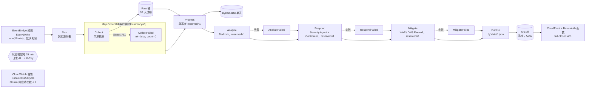

# Security Radar 01：整体架构与工程护栏

研究对象：[aws-samples/sample-security-radar](https://github.com/aws-samples/sample-security-radar)，提交 `7d5362e`。下文的 `path:line` 都指这个提交。链接前缀统一为 `https://github.com/aws-samples/sample-security-radar/blob/7d5362e/`。

这篇只讲两件事：系统怎么搭起来，以及代码里哪些机制在防止它出错、超支或泄露。情报聚类、分析、响应等业务逻辑在后续文档展开。

## 1. 一句话架构

一个 Step Functions（AWS Step Functions，状态机服务）状态机每 10 分钟跑一轮：先决定哪些情报源到期，再并发抓取，单写者入库到 DynamoDB（Amazon DynamoDB），然后依次做分析、响应、缓解，最后把 JSON 文档写进私有 S3（Amazon S3）桶，通过 CloudFront（Amazon CloudFront）加 Basic 认证对外提供只读界面。

每个 Lambda（AWS Lambda）函数都是一个"工位（station）"：短时运行，按 S3 key 或表读写，只返回小 JSON。顺序、重试、扇出都交给 Step Functions（`src/radar/handlers.py:1-2`）。

## 2. 三个 CDK 栈与区域划分

CDK（AWS Cloud Development Kit）应用入口在 `infra/app.py:8-18`，一次部署三个栈：

| 栈 | 区域 | 内容 | 为什么在这个区域 |
|---|---|---|---|
| `SecurityRadarContinuum` | us-east-1 | 代码/上下文/补丁桶、Continuum 集成角色 | AWS Continuum 在 ap-northeast-1 没有端点（`infra/continuum_stack.py:1`） |
| `SecurityRadarMitigateDemo` | us-east-1 | 空规则的 WAF（AWS WAF）web ACL + 拒绝一切请求的 CloudFront 分发 | CLOUDFRONT 作用域的 web ACL 只能建在 us-east-1（`infra/mitigate_stack.py:1`） |
| `SecurityRadar` | ap-northeast-1 | 主体：状态机、全部 Lambda、表、桶、站点、Security Agent 资源 | 主部署区域 |

```python
stacks = [ContinuumStack(app, f"SecurityRadarContinuum{suffix}", stage=stage, env=cdk.Environment(region="us-east-1")),
          MitigateDemoStack(app, f"SecurityRadarMitigateDemo{suffix}", stage=stage, env=cdk.Environment(region="us-east-1")),
          RadarStack(app, f"SecurityRadar{suffix}", stage=stage, env=cdk.Environment(region="ap-northeast-1"))]
```

来源：[infra/app.py#L12](https://github.com/aws-samples/sample-security-radar/blob/7d5362e/infra/app.py#L12)

跨区域引用不走 CloudFormation 导出。所有资源名由 stage 确定性地推导，东京栈直接拼出 us-east-1 的桶名和角色 ARN（`infra/continuum_stack.py:3-5`，`prefix()` 在 `:18-20`，`bucket_name()` 在 `:31-32`；东京侧使用见 `infra/stack.py:119-120`）。这样避免了跨区域导出带来的部署耦合。

两处"资源由 CFN 创建、内容由运行时拥有"的设计值得注意：

- WAF demo 的 web ACL 用 `rules=[]` 创建（`infra/mitigate_stack.py:30-35`）。文档字符串写明：模板里不能带规则，否则栈更新会抹掉缓解工位暂存或人工提升的规则（`infra/mitigate_stack.py:5-7`）。
- DNS Firewall（Amazon Route 53 Resolver DNS Firewall）的域名列表和规则同样是运行时状态，CFN 从不设置它们（`infra/stack.py:189-190`）。

## 3. 流水线：Step Functions 状态机

### 3.1 工位与顺序



状态机定义是一条直链（`infra/stack.py:264-271`）：

```python
definition = (invoke("Plan", plan_fn)
              .next(fan_out)
              .next(invoke("Process", process_fn, payload=sfn.TaskInput.from_object(
                  {"results.$": "$.results", "full.$": "$.full"})))
              .next(analyze_step)
              .next(respond_step)
              .next(mitigate_step)
              .next(publish_task))
```

来源：[infra/stack.py#L264](https://github.com/aws-samples/sample-security-radar/blob/7d5362e/infra/stack.py#L264)

各工位 Lambda 的参数（`infra/stack.py:85-100`、`:121`、`:180`）：

| 工位 | handler | 超时 | 内存 | 预留并发 |
|---|---|---|---|---|
| Plan | `plan` | 30 s | 512 MB | — |
| Collect | `collect_one` | 180 s | 512 MB | — |
| Process | `process` | 600 s | 1024 MB | 1 |
| Analyze | `analyze_events` | 600 s | 512 MB | 1 |
| Respond | `respond_events` | 600 s | 1024 MB | 1 |
| Mitigate | `mitigate_events` | 300 s | 512 MB | 1 |
| Publish | `publish_site` | 300 s | 1024 MB | — |

全部是 Python 3.12、ARM64，日志组保留一个月（`infra/stack.py:76-83`）。

### 3.2 关键参数

- **周期**：`CYCLE_MINUTES = 10`（`infra/stack.py:30`），EventBridge（Amazon EventBridge）规则在 `:279-281`。
- **扇出并发**：`sfn.Map(..., max_concurrency=6)`（`infra/stack.py:249`）。每个元素只带 `source_id` 和本轮 `slot`（`:250`）。
- **单写者**：Process 设 `reserved_concurrent_executions=1`，注释写明目的是"no concurrent cluster/merge races"（`infra/stack.py:90-91`）。Analyze、Respond、Mitigate 也都是 1（`:94`、`:121`、`:180`），它们各自是 DynamoDB 里某些账本项的唯一写者（例如 `DIGEST_KEY`、`DUP_KEY` 的注释，`src/radar/handlers.py:131-132`）。
- **超时**：整个状态机 25 分钟（`infra/stack.py:274`）。
- **重试**：每个 LambdaInvoke 只对 Lambda 服务侧瞬时错误重试 3 次，间隔 5 s、倍率 2（`infra/stack.py:239-243`）。业务异常不重试。
- **可观测**：日志级别 ALL，但 `include_execution_data=False`，X-Ray 开启（`infra/stack.py:272-277`）。这是为了满足 cdk-nag 的 SF1/SF2，同时不把载荷写进日志。

### 3.3 失败捕获：谁可以失败，谁不可以

| 位置 | 处理 | 代码 |
|---|---|---|
| 单个 Collect | `States.ALL` 被捕获，转为 `{"ok": false, "count": 0, "key": null}`，Map 继续 | `infra/stack.py:246-248` |
| Analyze | 捕获后跳到 Respond，错误写入 `$.analyze_error` | `infra/stack.py:258-259` |
| Respond | 捕获后跳到 Mitigate | `infra/stack.py:260-261` |
| Mitigate | 捕获后跳到 Publish | `infra/stack.py:262-263` |
| Plan / Process / Publish | 无 catch，失败即本轮执行失败 | `infra/stack.py:264-271` |

注释原文："neither station may block publishing"（`infra/stack.py:257`）。也就是说付费、外部依赖多的三个工位失败时，站点照常用已有状态发布。

Process 失败不会丢数据。Collect 已经推进了游标，原始批次留在 S3；下一轮 Process 会扫描今天和昨天所有未标记为已处理的批次（`src/radar/handlers.py:57-64`），并且只在 ingest 成功后才打 `RAW#...DONE` 标记（`:76-77`）。

> 观察：Process 预留并发为 1，而周期 10 分钟、状态机超时 25 分钟。如果上一轮还在 Process，下一轮的 Process 调用会被限流，`Lambda.TooManyRequestsException` 只重试 3 次（约 35 s），之后本轮执行失败。数据不丢（见上），但会计入"没有成功周期"。这是由代码推导出的行为，未在线上验证。

## 4. 情报源注册表：失败和"没有新闻"必须分开

### 4.1 注册表就是代码

`src/radar/registry.py:1` 把自己定义为"what we collect 的唯一真相来源（code, not docs）"。每个源是一个冻结的 `Source` dataclass（`:17-32`），字段包括 tier（T1/T2/T3 可信度分层，定义在 `:3-6`）、parser 名、URL、`cadence_min`、`via`（直连或 firecrawl）、`enabled`。`SOURCES` 元组在 `:73`，当前 25 个源，其中 2 个 `enabled=False`。`BY_ID` 索引在 `:132`。

`parser` 字段是 `radar.parsers.PARSERS` 的键（`src/radar/parsers/__init__.py:178-181`），目前 7 个解析器：`feed`、`kev`、`defillama`、`slowmist`、`defihacklabs`、`twitterapi`、`binance_cms`。

Plan 工位用 `collect.due()` 选出到期源：距上次运行超过 `cadence_min - 1 分钟` 即到期（`src/radar/collect.py:17-25`）。减 1 分钟是为了容忍 10 分钟周期的调度抖动。

### 4.2 0 条结果当作错误

```python
raws: list[RawItem] = [] if resp.status == 304 else parsers.PARSERS[source.parser](resp.body, source.source_id)
if resp.status == 200 and not raws and source.parser != "twitterapi":
    # a feed/DB that parses to nothing is broken (block page, format change), not "no news"
    raise fetch.FetchError("parse_empty", f"0 entries parsed from {len(resp.body)} bytes", 200, source.url)
```

来源：[src/radar/collect.py#L42](https://github.com/aws-samples/sample-security-radar/blob/7d5362e/src/radar/collect.py#L42)

规则很直接：

- HTTP 304（条件 GET 命中，`src/radar/fetch.py:50-57` 发送 `If-None-Match` / `If-Modified-Since`）合法地返回 0 条。
- HTTP 200 但解析出 0 条，视为被拦截页或格式变更，抛 `parse_empty`。X 搜索（`twitterapi`）例外，因为一段时间内账号确实可能不发帖。
- 异常被捕获后，**不推进游标**（etag/last_modified 只在成功分支更新，`:54-55`），写入 `last_error`、`last_error_at`，`consecutive_failures` 加 1（`:56-60`）。

发布侧把状态翻译成给人看的词（`src/radar/publish.py:172-180`）：

| 状态 | 条件 |
|---|---|
| `disabled` | `enabled=False` |
| `never_run` | 没有 `last_run` |
| `failing` | 连续失败 ≥ `SOURCE_FAILING_AFTER = 3`（`src/radar/limits.py:53`） |
| `degraded` | 连续失败 1-2 次 |
| `ok` | 其他 |

`sources.json` 同时输出 `last_error` 和 24 小时条数（`src/radar/publish.py:183-196`）。运维视图把 `failing` 列为 error、`degraded` 列为 warn（`src/radar/ops.py:17-23`）。

这三条规则各有一条变异（mutation，见第 8 节）守着：M12 把失败计数清零、M18 去掉空解析检查、M13 把 `never_run` 改成 `ok`（`mutations.txt:68-80`、`:104-110`）。

### 4.3 网络边界

`fetch.urlopen()` 是全项目唯一打开 URL 的地方，只允许 http/https，`file:` 等协议直接拒绝（`src/radar/fetch.py:39-47`）。响应体上限 `HTTP_MAX_BYTES = 20_000_000`，超过即 `too_large`（`:59-62`；常量在 `src/radar/limits.py:52`），超时 `HTTP_TIMEOUT_S = 25`（`src/radar/limits.py:32`）。`FetchError` 统一携带机器码、人类可读消息和实际值（`src/radar/fetch.py:23-28`）。

## 5. DynamoDB 单表

表定义：分区键 `pk`、排序键 `sk`，按需计费，开启 PITR（时间点恢复），一个 GSI（全局二级索引）`gsi1`（`infra/stack.py:60-67`）。

行布局写在 `src/radar/dynamo.py:1-8`：

| pk | sk | 内容 | 备注 |
|---|---|---|---|
| `ITEM#<id>` | `META` | 单条原始情报 | |
| `EVENT#<id>` | `META` | 聚合后的事件 | `gsi1pk="EVENT"`，`gsi1sk=last_updated` |
| `EVENT#<id>` | `RESPONSE` | 响应工位状态（AWS 作业记录） | 与事件分行存放 |
| `KEY#<key>` | `EVENT#<id>` | 聚类键 → 事件的反向索引 | |
| `SRC#<id>` | `STATE` | 源状态；也存 `__funnel__`、`__continuum__` 等账本 | |
| `RAW#<s3key>` | `DONE` | 原始批次已入库的续跑标记 | |

几个实现细节：

- 值统一序列化成 JSON 字符串放在属性 `d` 里，避开 boto3 的 Decimal 转换问题（`src/radar/dynamo.py:1`、`:34`）。
- "最近 N 天更新的事件"走 `gsi1` 范围查询，分页读完（`src/radar/dynamo.py:71-78`）。
- 基表读取一律 `ConsistentRead=True`（`:24-27`、`:42`、`:63`）。测试注释记录了原因：2026-10-23 第一次线上周期，PutItem 后紧跟的 BatchGetItem 在最终一致读下拿不到数据（`tests/test_store_contract.py:48-50`）。
- 响应状态与事件分行，是因为 Process 每轮会重写事件，不能与 AWS 作业记录竞争或把它抹掉（`src/radar/store.py:25-26`）。

### 存储契约测试

`Store` 是一个 Protocol（`src/radar/store.py:13-29`），有 `MemoryStore` 和 `DynamoStore` 两个实现。`MemoryStore` 每次读写都做 JSON 往返，让测试能发现 DynamoDB 存不下的值（`:40-46`）。`tests/test_store_contract.py:29-38` 用同一份回放数据分别喂给两个实现，断言产出的事件 JSON 完全一致，并且第二次 ingest 的新增和更新都是 0（幂等）。DynamoDB 用 moto 模拟。

## 6. 发布：S3 + CloudFront，以及"先验证 401 再上传"

### 6.1 站点

- 两个桶（Raw、Site）都是 `BLOCK_ALL`、S3 托管加密、`enforce_ssl=True`（`infra/stack.py:52-55`）。Raw 桶 90 天过期（`:57`）。
- Publish 工位只有 Site 桶的 put 权限（`infra/stack.py:100`），把 `publish.build()` 返回的每个文档写到 `data/<path>`，`CacheControl="max-age=60"`（`src/radar/handlers.py:184-195`）。`publish.build()` 是纯函数（`src/radar/publish.py:1-2`）。
- CloudFront 通过 OAC（Origin Access Control）访问 Site 桶，强制 HTTPS，挂托管安全响应头策略，viewer-request 阶段挂 Basic Auth 函数（`infra/stack.py:297-305`）。

### 6.2 Basic Auth 函数：fail-closed

UI 密码由 Secrets Manager（AWS Secrets Manager）生成，24 位、无标点（`infra/stack.py:290-293`）。CloudFront 只拿到 SHA-256 哈希，存在 CloudFront KeyValueStore 的 `basic_auth_sha256` 键里（`scripts/set-ui-auth.sh:10-18`）。

`infra/basic_auth.js` 的判断（`:19-44`）：

- 没有 `Authorization` 头 → 401。
- 读 KeyValueStore 抛异常 → 401。
- 哈希为空 → 401。
- 长度不是 64 的条目永不匹配；比较对每个条目都完整做完，用按位或累计差异，避免时序泄露是哪个用户匹配（`:35-42`）。

```javascript
for (let k = 0; k < parts.length; k++) {  // every entry is compared: timing does not reveal which user matched
  const h = parts[k];
  if (h.length !== 64) continue;  // malformed entries never match
  valid++;
  let diff = 0;
  for (let i = 0; i < 64; i++) diff |= got.charCodeAt(i) ^ h.charCodeAt(i);
  ok |= diff === 0 ? 1 : 0;
}
return valid > 0 && ok ? req : DENY;
```

来源：[infra/basic_auth.js#L35](https://github.com/aws-samples/sample-security-radar/blob/7d5362e/infra/basic_auth.js#L35)

`:30` 的注释记录了一个线上教训：cloudfront-js-2.0 不支持 `for...of`，2026-10-26 曾导致全站 503。变异 M55 专门把这个循环改回 `for...of`，要求 `tests/test_basic_auth_fn.py::test_no_syntax_cloudfront_js_rejects` 变红（`mutations.txt:326-332`）。

### 6.3 部署顺序

`scripts/deploy-all.sh:8-9` 写明顺序："infrastructure with an EMPTY site → auth gate armed → anonymous request must be denied by the gate (401 + WWW-Authenticate) → only then upload the UI"。

```bash
step "verify anonymous access is denied by the gate BEFORE any content is uploaded"
site=$(out SiteUrl)
for i in $(seq 1 30); do
  hdr=$(curl -s -o /dev/null -D - "$site/" || true)
  if printf '%s' "$hdr" | grep -qi '^www-authenticate: Basic'; then echo "anonymous → 401 (gate)"; break; fi
  [ "$i" = 30 ] && { echo "gate not observed — refusing to upload content" >&2; exit 1; }
  sleep 10
done
```

来源：[scripts/deploy-all.sh#L33](https://github.com/aws-samples/sample-security-radar/blob/7d5362e/scripts/deploy-all.sh#L33)

完整步骤（`scripts/deploy-all.sh:17-48`）：

1. 构建 Lambda 包和目标代码库。
2. `cdk deploy` 三个栈，CDK 版本钉死 `aws-cdk@2.1146.1`（`:25`）。
3. `set-ui-auth.sh` 把哈希写入 KeyValueStore。
4. 最多轮询 5 分钟（30 × 10 s），必须看到 `WWW-Authenticate: Basic`，否则退出，不上传内容。
5. 有 `~/.env` 时同步采集器密钥（通过 stdin）。
6. 上传 UI。
7. `verify.sh --run` 触发一轮并验收。

调度开关也配合这个顺序：CDK 里 EventBridge 规则默认 `enabled=False`，只有 `-c schedule=on` 才打开（`infra/stack.py:278-281`）。`deploy-all.sh` 默认传 `schedule=on`（`:22`），所以单独 `cdk deploy` 不会让流水线在门禁就绪前开始往桶里写数据。

### 6.4 验收脚本

`scripts/verify.sh` 每项打印 PASS/FAIL，有失败则退出码 1（`:9`、`:63`）。检查项包括：

- `--run` 时启动一轮执行并等待 SUCCEEDED，最多 15 分钟（`:12-22`）。
- 匿名请求 401、错误凭证 401、正确凭证 200（`:29-31`）。凭证头写进 `chmod 600` 的临时文件，不进 argv（`:25`）。
- `events.json`、`sources.json`、`continuum.json` 已发布（`:32-34`）。
- Site 桶 `RestrictPublicBuckets=True`（`:35-36`）。
- S3 通道的目标 zip 必须在 Continuum 桶里，非 S3 通道的必须**不在**（`:39-50`）。原因是这个桶里每个 zip 都会被扫描并计费（`:41-42`）。

## 7. IAM 最小权限

### 7.1 栈里的做法

- 每个 Lambda 通过 `fn()` 只拿到表的读写（`infra/stack.py:82`）；桶权限逐个授予：Collect 只能写 Raw（`:89`），Process 只能读 Raw（`:92`），Publish 只能写 Site（`:100`），Respond 只能写 Site 的 `data/continuum/*`（`:176`）。
- Collect 是唯一能读采集器密钥的函数（`infra/stack.py:87-88`）。密钥值从不进代码或模板（`:69`）。
- Bedrock（Amazon Bedrock）只授予 `InvokeModel`/`Converse`，资源限定为 `global.anthropic.claude-*` 推理配置文件和 Claude 基础模型（`infra/stack.py:95-98`）。
- Security Agent 的审查类动作限定在本栈的 agent space ARN，需求包类动作限定在本栈的 pack ARN（`infra/stack.py:142-149`）。
- Continuum 的环境在运行时创建，合成时拿不到 ID，所以限定到本账号 us-east-1 的 `environments/*` 和 `integrations/*`（`infra/stack.py:150-155`）。
- `ce:GetCostAndUsage` 只能 `*`，注释说明该动作没有资源级权限（`infra/stack.py:167-168`）。
- `iam:PassRole` 只能传 Security Agent 服务角色和 Continuum 集成角色（`infra/stack.py:169`）。
- 缓解工位单独一个角色，"the respond role never gets WAF write"（`infra/stack.py:178-179`）。WAF 写操作只允许 `security-radar-*` 前缀的 web ACL（`:185-188`）；DNS Firewall 写只允许本栈的规则组和域名列表（`:210-214`）。
- 服务角色的信任策略都钉了 `aws:SourceAccount`（`infra/stack.py:104-105`；`infra/continuum_stack.py:44-45` 另加 `sts:ExternalId`）。Continuum 集成角色只能读 `code/*`、`context/*`，只能写 `continuum-patches/*`（`infra/continuum_stack.py:46-50`）。

### 7.2 test_iam_scope：把 IAM 动作和真实 API 调用绑在一起

问题背景写在测试文档字符串里：代码里新增调用却没加权限，线上会以 AccessDenied 失败，而且被当作普通失败吞掉，不容易发现；反过来，删了调用却留着权限，就是没人用的特权（`tests/test_iam_scope.py:1-5`）。

做法是双向静态比对，不导入 CDK：

1. 用 `ast` 读 `infra/stack.py` 顶层的 `SA_REVIEW_ACTIONS`、`SA_PACK_ACTIONS`、`CN_ACTIONS` 字面量（`tests/test_iam_scope.py:14-18`）。所以这些列表必须定义成模块级常量（`infra/stack.py:31-42`）。
2. 用 `ast` 遍历 `src/radar/continuum_aws.py`，收集所有通过 `sa`/`cn` 变量或 `_sa()`/`_cn()` 调用访问的属性名，排除 `meta`、`exceptions`（`tests/test_iam_scope.py:21-34`）。
3. snake_case 转 CamelCase 后，两个集合必须**相等**（`:41-44`）。

```python
def test_iam_actions_equal_the_calls_in_code():
    c, calls = _constants(), _calls()
    assert {_camel(x) for x in calls["sa"]} == set(c["SA_REVIEW_ACTIONS"]) | set(c["SA_PACK_ACTIONS"])
    assert {_camel(x) for x in calls["cn"]} == set(c["CN_ACTIONS"])
```

来源：[tests/test_iam_scope.py#L41](https://github.com/aws-samples/sample-security-radar/blob/7d5362e/tests/test_iam_scope.py#L41)

另外两条断言：

- 栈源码里不能出现 `"securityagent:*"` 或 `"continuum:*"`（`tests/test_iam_scope.py:47-49`）。
- WAF 读写动作同样与 `mitigate_aws.py` 中 `_waf()` 的调用相等（大小写不敏感，因为 `update_web_acl` 转回去是 `UpdateWebAcl` 而不是 `UpdateWebACL`）；写权限必须带 `global/webacl/security-radar-*/*`，不能有 `"wafv2:*"`；`mitigate.RADAR_ACL_PREFIX` 必须等于 `"security-radar-"`（`:58-68`）。

变异 M66 从 `SA_REVIEW_ACTIONS` 删掉 `ListFindings`，要求这个测试变红（`mutations.txt:394-398`）。

### 7.3 cdk-nag

CI 用 `cdk synth -c nag=on` 跑 AwsSolutions 规则包，任何未解释的发现都会让 synth 失败（`infra/app.py:15-17`，`.github/workflows/ci.yml:44-47`）。

`infra/nag.py` 的约定：

- 抑制项集中在一个 `REASONS` 字典里，每条写明为什么不适用于这个示例、生产环境应该怎么做（`infra/nag.py:8-27`）。例如 CFR2 写"生产环境应放到 Amazon Cognito / IAM Identity Center 和 AWS WAF 后面"（`:21-22`）。
- 已经在栈里修掉的规则不列入（文档字符串点名了 VPC7 流日志、SF1/SF2 状态机日志和 X-Ray，`infra/nag.py:1-3`）。对应修复在 `infra/stack.py:191-196`（VPC 流日志）和 `:272-277`（状态机日志 + X-Ray）。
- 抑制按栈施加（`add_stack_suppressions`），不是按资源（`infra/nag.py:30-34`）。

> 观察：`AwsSolutions-DDB3` 的抑制理由写"表里是可重建状态，不需要 PITR"（`infra/nag.py:26`），但表实际已开启 PITR（`infra/stack.py:62-64`）。这条抑制已无作用，与文件"修掉的规则不列入"的约定不一致。

## 8. 变异注册表（mutation registry）

### 8.1 是什么

`mutations.txt` 是一份 INI 格式清单，供外部工具 touchstone 的 `tools/mutate.py` 使用（`mutations.txt:1-2`）。每个条目删掉或削弱一个护栏，并声明哪个测试应当因此变红：

```ini
[M18 empty parse of a 200 reported as ok]
file = src/radar/collect.py
find = if resp.status == 200 and not raws and source.parser != "twitterapi":
replace = if False:
expect = tests/test_collect.py::test_empty_parse_of_a_200_is_a_failure_not_silence
```

来源：[mutations.txt#L104](https://github.com/aws-samples/sample-security-radar/blob/7d5362e/mutations.txt#L104)

当前根目录注册表有 215 个条目，`ui/mutations.txt` 另有 76 个。运行方式见 `CONTRIBUTING.md:73`；规则"新护栏需要一个测试**和**一条能让它变红的变异"见 `CONTRIBUTING.md:83`。

抽样几条，能看出覆盖范围：

| 条目 | 被拆掉的护栏 | 位置 |
|---|---|---|
| M12 | 采集失败不计数 | `mutations.txt:68-74` |
| M13 | 从未运行的源显示为 ok | `mutations.txt:76-80` |
| M36 | 忽略每日审查预算（`elif budget.reviews_left > 0:` → `elif True:`，`src/radar/respond.py:422`） | `mutations.txt:214-218` |
| M55 | CloudFront 函数里用 `for...of` | `mutations.txt:326-332` |
| M66 | IAM 动作列表与代码调用漂移 | `mutations.txt:394-398` |
| M80 | 预算判断只看有花费的天 | `mutations.txt:478-482` |

条目标题里大量带金额或线上事故（例如 M76 "≈ $1.4k/day"、M82 "≈ $450 each"，`mutations.txt:454`、`:490`），也就是说注册表同时记录了"为什么有这条护栏"。

### 8.2 怎么证明护栏有测试

完整的变异运行逐条应用 `replace`、跑测试、要求变红，作者记录需要约 15 分钟（`tests/test_mutation_registry.py:2-4`）。因此仓库另有一个快速测试，只检查锚点：

```python
@pytest.mark.parametrize(("name", "path", "find"), ALL, ids=[e[0] for e in ALL])
def test_every_mutation_anchor_is_unique_in_its_file(name, path, find):
    assert path.exists(), f"{name}: {path} does not exist"
    assert path.read_text().count(find) == 1, f"{name}: anchor found {path.read_text().count(find)}x in {path.name}"
```

来源：[tests/test_mutation_registry.py#L26](https://github.com/aws-samples/sample-security-radar/blob/7d5362e/tests/test_mutation_registry.py#L26)

它要求每个 `find` 在目标文件里恰好出现一次（`:26-29`），并断言条目总数大于 200（`:23`），防止注册表被意外清空。动机写在文档字符串：2026-10-30 有 5 个条目因为代码改动让锚点改变或重复，"stale anchor is a guard that is no longer verified"（`:2-5`）。这个测试自己也说明了边界：它不证明测试会变红，只证明每条变异仍指向真实、唯一的代码。

## 9. 成本护栏

所有阈值集中在 `src/radar/limits.py` 的 `Limits` 类，测试直接导入常量而不是重复写字面量（`src/radar/limits.py:1-2`）。与成本相关的：

| 常量 | 值 | 含义 | 位置 |
|---|---|---|---|
| `SA_REVIEWS_PER_DAY` | 6 | 滚动 24 h 内付费 Security Agent 代码审查次数（约 27 分钟、$10/CIU 一次） | `limits.py:60` |
| `CONTINUUM_SCAN_MIN_INTERVAL_H` | 24 | 每个环境每天最多 1 次付费扫描（实测约 $450 一次） | `limits.py:70` |
| `CONTINUUM_DAILY_USD_CAP` | 500 | 预算线：超过只标记，不阻止扫描 | `limits.py:61` |
| `CONTINUUM_SCHEDULED_SCAN` | `"PT0H"` | 关闭 Continuum 自带定时扫描，只由雷达触发 | `limits.py:62` |
| `RESPOND_MAX_EVENTS` | 8 | 每轮最多处理的事件数 | `limits.py:59` |
| `RESPOND_WINDOW_DAYS` | 7 | 只考虑 7 天内更新的事件 | `limits.py:58` |
| `COST_REFRESH_H` | 6 | Cost Explorer 读取间隔（每次请求 $0.01） | `limits.py:63` |
| `INSPECTOR_SCANS_PER_DAY` | 5 | Inspector ScanSbom 每天次数 | `limits.py:68` |
| `NOTIFY_MAX_PER_CYCLE` | 10 | 每通道每轮消息数 | `limits.py:64` |
| `MAX_ANALYSES_PER_CYCLE` | 6 | 每轮 Bedrock 分析次数（约 30 s 一次） | `handlers.py:28` |

执行位置：

- **审查预算**：Respond 先把账本里 24 小时前的审查时间戳清掉，剩余额度 = `per_day - len(reviews)`（`src/radar/handlers.py:357-358`、`:371`）。`per_day` 可被环境变量 `SA_REVIEWS_PER_DAY` 覆盖（`:360`），这个变量只在 CDK 上下文传了 `review_budget` 时才设置，默认值留在 `Limits` 里（`infra/stack.py:137-138`；部署脚本入口 `scripts/deploy-all.sh:24`）。
- **每 24 h 一次扫描**：`_scan_open()` 比较该通道上次扫描时间与 `now - 24h`（`src/radar/handlers.py:207-210`）。每个通道（s3/github/gitlab）有自己的时钟键（`:203-204`）。
- **预算线**：`cost.over_cap()` 看最近两个日历日（Cost Explorer 有约 24 h 延迟），零花费日也算在内（`src/radar/cost.py:24-31`）。超了只写 `led["over_budget"]` 并记 warning（`src/radar/handlers.py:364-369`），运维视图显示为 warn（`src/radar/ops.py:26-29`）。注释说明这是有意设计："a budget line to show, not a brake"，花费靠扫描规则控制（`src/radar/handlers.py:361-363`）。
- **读取成本本身也限流**：`cost.due()` 取上次成功和上次失败中较晚的那个，失败也要等 6 小时再试（`src/radar/cost.py:17-21`）。读取失败时保留上次数字，并显示 `cost_unavailable`（`src/radar/handlers.py:489-495`）。

## 10. 无成功周期告警

```python
cw.Alarm(self, "NoSuccessfulCycle", alarm_description="security-radar: no successful cycle in 30 minutes",
         metric=machine.metric_succeeded(period=Duration.minutes(30), statistic="Sum"),
         threshold=1, evaluation_periods=1, comparison_operator=cw.ComparisonOperator.LESS_THAN_THRESHOLD,
         treat_missing_data=cw.TreatMissingData.BREACHING)
```

来源：[infra/stack.py#L284](https://github.com/aws-samples/sample-security-radar/blob/7d5362e/infra/stack.py#L284)

这是一个"死人开关"：30 分钟窗口内状态机成功次数之和小于 1 就告警（`infra/stack.py:283-287`）。关键是 `treat_missing_data=BREACHING`：调度停了、没有数据点，也算告警，而不是静默。30 分钟对应 3 个周期，偶发一次失败不会触发。

注释写明通知还没接（"notification wiring deferred: push is M2"，`infra/stack.py:283`），所以告警目前只在 CloudWatch（Amazon CloudWatch）里可见。

## 11. STAGE 隔离与销毁安全

### 11.1 隔离

- `-c stage=<name>` 部署一套完整的独立副本，默认空 stage 是线上部署（`infra/app.py:9-11`）。栈名加首字母大写的后缀（`:11-14`）。
- 所有确定性名称从 `prefix(stage)` 推出：`security-radar` 或 `security-radar-<stage>`（`infra/continuum_stack.py:18-20`）。Continuum 集成角色、ExternalId、桶名、WAF demo ACL 名都走它（`:23-32`，`infra/mitigate_stack.py:21-23`）。
- 非默认 stage 被视为一次性副本：`RemovalPolicy.DESTROY` + `auto_delete_objects=True`；线上则是 `RETAIN`（`infra/stack.py:48-49`、`:52-55`；`infra/continuum_stack.py:40-41`）。
- 账号级资源只归线上：Security Hub（AWS Security Hub）一个账号一个区域只能有一个，所以只有 `not stage` 且显式 `-c security_hub=on` 才创建，并且不开默认标准（`infra/stack.py:224-232`）。
- 脚本侧，`scripts/lib.sh:3` 要求必须设置 `AWS_PROFILE`（`${AWS_PROFILE:?...}`），没有就退出。输出文件按 stage 分开：`build/outputs-<stage>.json`（`:6`）。

### 11.2 销毁

`scripts/destroy-stage.sh:7` 在 STAGE 为空时拒绝执行：

```bash
[ -z "$STAGE" ] && { echo "refusing: STAGE is empty (that is the live deployment)" >&2; exit 1; }
```

来源：[scripts/destroy-stage.sh#L7](https://github.com/aws-samples/sample-security-radar/blob/7d5362e/scripts/destroy-stage.sh#L7)

之后先用 boto3 清理 CFN 管不到的东西，再 `cdk destroy` 三个栈（`:36-37`）：

- 删除 agent space 里由 Lambda 创建的代码审查（`:13-18`）。
- 清空需求包里 Lambda 添加的规则，因为 CFN 删不掉非空的 pack（`:19-24`）。
- 按名称删除 Continuum 环境和集成；集成删除失败时只打印，因为环境删除可能还在传播（`:25-34`）。

> 观察：`scripts/destroy-stage.sh:10` 写成 `uv run -q python -I -   # boto3 ... "$name" "$pack" "$space" <<'PY'`。在 bash 里 `#` 之后整行都是注释，所以参数和 here-doc 重定向都被注释掉了。结果是 Python 从终端读 stdin，而 `import sys, boto3` 等行会被当成 shell 命令执行。我在 `$KIROCREW_SCRATCH` 里用同样结构的最小脚本复现：here-doc 正文作为 shell 命令执行，`PY` 行报 `command not found`，退出码 127。在 `set -e` 下脚本会在执行到 `cdk destroy` 之前退出。修法是把注释移到行尾 `<<'PY'` 之后，或单独成行。已报告上游：[aws-samples/sample-security-radar#13](https://github.com/aws-samples/sample-security-radar/issues/13)。

## 12. 其他仓库级护栏

- **私有配置不入库**：`tests/test_no_private_config.py` 遍历 `git ls-files`，用正则查 Lark app/chat/open_id、Slack token 和 webhook（`:9-15`、`:23-31`）。测试样例在运行时拼接，避免源码里出现像 token 的字面量被公开扫描器误报（`:34-38`）。
- **gitleaks**：保留默认规则，只放行以太坊地址 `0x` + 40 位十六进制，理由是链上地址是公开标识（`.gitleaks.toml:1-10`）。
- **CI**：只在 `v*` 标签或手动触发时运行（`.github/workflows/ci.yml:1-7`），`GITHUB_TOKEN` 只有 `contents: read`（`:10-11`），所有 Action 钉到提交 SHA（`:17-18`）。三个 job：ruff + pytest、UI 测试 + 构建 + a11y、cdk-nag synth（`:14-47`）。

本地只读运行 `tests/test_iam_scope.py`、`tests/test_no_private_config.py`、`tests/test_store_contract.py`、`tests/test_mutation_registry.py`、`tests/test_collect.py`、`tests/test_cost.py`：312 passed，29 s。

## 可复用模式

### 1. 0 条结果即错误

- 问题：上游被拦截或改版时，解析器返回空列表，看起来和"今天没新闻"一样，故障被静默。
- 做法：HTTP 200 且解析结果为空就抛带机器码的错误；失败不推进游标；连续失败计数，≥3 次显示为 failing；"从未运行"单独成一个状态，不当 ok。
- 代码位置：`src/radar/collect.py:42-60`，`src/radar/publish.py:172-180`，`src/radar/limits.py:53`。

### 2. IAM 动作与 SDK 调用双向相等的静态测试

- 问题：加了调用忘了加权限，线上才 AccessDenied；删了调用留着权限，变成无人使用的特权。
- 做法：IAM 动作列表写成栈文件的模块级常量；测试用 `ast` 读常量，再用 `ast` 收集客户端对象上的属性调用，转 CamelCase 后断言集合相等；再禁止 `service:*` 字面量。不需要导入 CDK。
- 代码位置：`infra/stack.py:31-42`，`tests/test_iam_scope.py:14-68`。

### 3. 变异注册表 + 锚点唯一性快测

- 问题：护栏被重构掉或测试失效时没人知道；完整变异测试太慢，不能每次跑。
- 做法：每条护栏登记一条 `file/find/replace/expect`，由变异工具验证测试会变红；另加一个秒级测试，只断言每个 `find` 在文件里恰好出现一次，以及条目总数下限。条目标题写明拆掉护栏的后果（含金额）。
- 代码位置：`mutations.txt:1-8`，`tests/test_mutation_registry.py:14-29`，`CONTRIBUTING.md:83`。

### 4. 先验证门禁返回 401，再上传内容

- 问题：私有站点在认证还没生效的窗口里，内容可能已经公开可读。
- 做法：基础设施先以空源站部署，定时调度默认关闭；写入认证哈希后轮询匿名请求，必须看到 401 和 `WWW-Authenticate` 才上传 UI 并开启调度；认证函数任何异常都返回 401。
- 代码位置：`scripts/deploy-all.sh:30-45`，`infra/stack.py:278-281`，`infra/basic_auth.js:19-44`。

### 5. 付费或不稳定工位不能阻塞发布

- 问题：一个外部服务出错导致整条流水线不出结果，用户看到的是过期页面且不知道原因。
- 做法：单源抓取失败在 Map 内转成 `ok=false` 结果；分析、响应、缓解各自 catch 后跳到下一步，错误写进独立的 result path；入库工位失败则保留未处理批次，下一轮补上；再用 `treat_missing_data=BREACHING` 的"30 分钟无成功"告警兜底。
- 代码位置：`infra/stack.py:245-271`，`infra/stack.py:283-287`，`src/radar/handlers.py:57-77`。

### 6. stage 派生全部资源名，销毁脚本拒绝空 stage

- 问题：复现部署和线上部署共用账号时，名称冲突或误删线上。
- 做法：一个 `prefix(stage)` 函数派生所有确定性名称，跨区域引用也靠它而不靠导出；非默认 stage 用 DESTROY + 自动清空桶，线上用 RETAIN；账号级单例资源只归线上；销毁脚本在 stage 为空时直接退出。
- 代码位置：`infra/continuum_stack.py:18-32`，`infra/stack.py:48-55`、`:224-228`，`scripts/destroy-stage.sh:7`。
