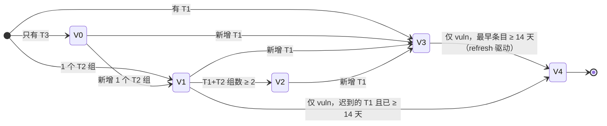
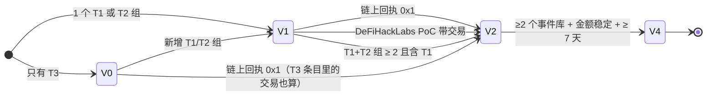

# 02 · 由代码判定真伪与紧急度，大语言模型只写句子

本文分析 aws-samples/sample-security-radar（提交 7d5362e，下称"雷达"）如何用确定性代码决定一个安全事件"是不是真的"和"有多急"，以及大语言模型（Large Language Model，下称 LLM）在哪里被调用、被怎样约束。

链接前缀统一为 `https://github.com/aws-samples/sample-security-radar/blob/7d5362e/`，下文写作 `path#Ln`。

核心原则写在数据模型的文件头里：事件的派生字段（验证级别、严重度、利用状态、金额）全部由代码从证据条目重算，LLM 从不写这些字段。

```python
"""Core data model. Items are what sources said; Events are what we believe happened.

Every derived field on Event (level, severity, exploitation, amounts) is recomputed by code from its
items — never written by an LLM and never edited in place by hand."""
```

见 [src/radar/model.py#L1](https://github.com/aws-samples/sample-security-radar/blob/7d5362e/src/radar/model.py#L1)。流水线文件头同样声明"同样的输入、同样的顺序，得到同样的事件、级别和时间线；本模块不调用 LLM"（[src/radar/pipeline.py#L1](https://github.com/aws-samples/sample-security-radar/blob/7d5362e/src/radar/pipeline.py#L1)）。

所有阈值集中在一个类里：[src/radar/limits.py#L7](https://github.com/aws-samples/sample-security-radar/blob/7d5362e/src/radar/limits.py#L7)。测试直接引用这些常量，不重复写字面量。

## 1. 四步流水线：normalize → cluster → verify → score

| 步骤 | 函数 | 输入 → 输出 |
|---|---|---|
| 归一化（normalize） | `pipeline.normalize`（[pipeline.py#L74](https://github.com/aws-samples/sample-security-radar/blob/7d5362e/src/radar/pipeline.py#L74)） | 原始条目 `RawItem` → 证据条目 `Item`：领域、来源等级、阻塞键、信号 |
| 聚类（cluster） | `find_events` / `attach`（[#L166](https://github.com/aws-samples/sample-security-radar/blob/7d5362e/src/radar/pipeline.py#L166)、[#L526](https://github.com/aws-samples/sample-security-radar/blob/7d5362e/src/radar/pipeline.py#L526)） | 条目 → 已有事件或新事件，必要时合并多个事件 |
| 验证（verify） | `independent_groups` + `_level`（[#L218](https://github.com/aws-samples/sample-security-radar/blob/7d5362e/src/radar/pipeline.py#L218)、[#L257](https://github.com/aws-samples/sample-security-radar/blob/7d5362e/src/radar/pipeline.py#L257)） | 证据集合 → 独立来源数、验证级别 V0–V4 |
| 打分（score） | `_exploitation` + `_severity`（[#L293](https://github.com/aws-samples/sample-security-radar/blob/7d5362e/src/radar/pipeline.py#L293)、[#L303](https://github.com/aws-samples/sample-security-radar/blob/7d5362e/src/radar/pipeline.py#L303)） | 级别 + 利用状态 + 金额 + 新鲜度 → P0/P1/P2 |

`recompute`（[#L433](https://github.com/aws-samples/sample-security-radar/blob/7d5362e/src/radar/pipeline.py#L433)）把验证和打分串起来。每次新条目进来、每次定时刷新（`refresh`，[#L589](https://github.com/aws-samples/sample-security-radar/blob/7d5362e/src/radar/pipeline.py#L589)）、每次链上验证（`verify_onchain`，[#L565](https://github.com/aws-samples/sample-security-radar/blob/7d5362e/src/radar/pipeline.py#L565)）都从全部条目重算，不做增量修改。

`ingest` 是幂等的：条目编号由来源编号和条目身份哈希得到，内容哈希不变就跳过（[pipeline.py#L497](https://github.com/aws-samples/sample-security-radar/blob/7d5362e/src/radar/pipeline.py#L497)）。测试 `test_replay_is_idempotent` 验证重复回放不产生变化（[tests/test_pipeline_replay.py#L131](https://github.com/aws-samples/sample-security-radar/blob/7d5362e/tests/test_pipeline_replay.py#L131)）。

### 1.1 归一化：领域、阻塞键、信号

**领域分类**（`_classify`，[pipeline.py#L56](https://github.com/aws-samples/sample-security-radar/blob/7d5362e/src/radar/pipeline.py#L56)）：三个领域 `vuln`（漏洞）、`incident`（一般安全事件）、`web3`（加密资产事件）。来源注册时可指定基础领域；否则文本命中加密词表 `_CRYPTO` 判为 web3，命中 CVE 或漏洞词判为 vuln，其余为 incident。web3 来源里出现 CVE 且没有攻击词时改判为 vuln。

**阻塞键**（blocking keys）分强弱两类（[pipeline.py#L30](https://github.com/aws-samples/sample-security-radar/blob/7d5362e/src/radar/pipeline.py#L30)、[#L35](https://github.com/aws-samples/sample-security-radar/blob/7d5362e/src/radar/pipeline.py#L35)）：

- 强键：`cve:`、`tx:`（交易哈希）、`attacker:`、`xs:`（X 推文编号）、`url:`。
- 弱键：`ent:`（结构化受害方名）、`tok:` / `tt:`（自由文本里的实体词，`tt:` 来自标题）。

关键规则：

- 一个条目列出的 CVE 超过 3 个时不登记 `cve:` 键，防止汇总文把无关漏洞粘在一起（[pipeline.py#L87](https://github.com/aws-samples/sample-security-radar/blob/7d5362e/src/radar/pipeline.py#L87)）。
- 美国网络安全与基础设施安全局（CISA）"已知被利用漏洞目录"（Known Exploited Vulnerabilities，KEV）的公告若列出 ≥2 个 CVE，标记为 `roundup`（[pipeline.py#L125](https://github.com/aws-samples/sample-security-radar/blob/7d5362e/src/radar/pipeline.py#L125)，正则在 [#L34](https://github.com/aws-samples/sample-security-radar/blob/7d5362e/src/radar/pipeline.py#L34)）。汇总条目可以挂到事件上，但它的 CVE 键不进索引，也不触发合并（`indexed_keys`，[#L159](https://github.com/aws-samples/sample-security-radar/blob/7d5362e/src/radar/pipeline.py#L159)）。
- 交易哈希只从区块浏览器 URL 中提取，裸的 64 位十六进制串不算，因为它也可能是区块哈希或签名（`keys.tx_refs`，[src/radar/keys.py#L61](https://github.com/aws-samples/sample-security-radar/blob/7d5362e/src/radar/keys.py#L61)；测试 [tests/test_keys_signals.py#L45](https://github.com/aws-samples/sample-security-radar/blob/7d5362e/tests/test_keys_signals.py#L45)）。
- 实体词去掉一张停用表 `MATCH_STOP`：币种、链名、混币器、报道黑客事件的安全公司和媒体（[keys.py#L97](https://github.com/aws-samples/sample-security-radar/blob/7d5362e/src/radar/keys.py#L97)）。注释记录了真实误合并：一个 "682 ETH … Tornado Cash" 事件通过 `tok:eth`、`cash` 等词吞并了币安热钱包被盗事件。
- 命名漏洞词（如 `PHP2Shell`、`CitrixBleed`）只认"字母加数字"或驼峰形式且 ≥5 字符，普通厂商名（Microsoft）被刻意排除（`named_tokens`，[keys.py#L151](https://github.com/aws-samples/sample-security-radar/blob/7d5362e/src/radar/keys.py#L151)）。

**规则信号**（[src/radar/signals.py](https://github.com/aws-samples/sample-security-radar/blob/7d5362e/src/radar/signals.py)）：

- 在野利用：先查否定句（"no evidence of exploitation"、"未发现…在野"），再查肯定句。结果三值 `yes` / `no` / `unclear`（`exploited`，[signals.py#L120](https://github.com/aws-samples/sample-security-radar/blob/7d5362e/src/radar/signals.py#L120)；否定正则 [#L11](https://github.com/aws-samples/sample-security-radar/blob/7d5362e/src/radar/signals.py#L11)）。KEV 条目直接为 `yes`（[pipeline.py#L106](https://github.com/aws-samples/sample-security-radar/blob/7d5362e/src/radar/pipeline.py#L106)）。
- 概念验证（Proof of Concept，PoC）公开：`signals.poc`（[signals.py#L27](https://github.com/aws-samples/sample-security-radar/blob/7d5362e/src/radar/signals.py#L27)）。
- 金额：取文本中最大的美元数（`parse_amount`，[signals.py#L158](https://github.com/aws-samples/sample-security-radar/blob/7d5362e/src/radar/signals.py#L158)）；每个金额再按所在分句判为 `loss`（损失）、`frozen`（冻结/追回）或 `context`（借贷、卖出、价格等背景数），见 `amount_mentions`（[signals.py#L184](https://github.com/aws-samples/sample-security-radar/blob/7d5362e/src/radar/signals.py#L184)）。

**能否单独开事件**（`eventful`，[pipeline.py#L112](https://github.com/aws-samples/sample-security-radar/blob/7d5362e/src/radar/pipeline.py#L112)）：

```python
    if source.always_eventful:
        eventful = True
    elif domain == "web3":
        eventful = signals.web3_incident(raw.title or raw.text) and (amount is not None or tier == "T1")
    else:
        eventful = bool(cve_list) or exploited == "yes" or (tier != "T3" and signals.security_event(raw.title))
```

不能开事件的条目只作为上下文存储，只能通过强键挂到已有事件。

**时间**：时间解析只在 `timeutil.parse` 一处，解析失败返回 `None`，不默认为"现在"（[src/radar/timeutil.py#L15](https://github.com/aws-samples/sample-security-radar/blob/7d5362e/src/radar/timeutil.py#L15)）。只有日期的输入定义为当天 00:00:00Z。

### 1.2 聚类：打分匹配与合并

`find_events`（[pipeline.py#L166](https://github.com/aws-samples/sample-security-radar/blob/7d5362e/src/radar/pipeline.py#L166)）按键查索引，给候选事件打分：强键每次命中 +10，弱键 +1（[#L183](https://github.com/aws-samples/sample-security-radar/blob/7d5362e/src/radar/pipeline.py#L183)）。弱键有三个附加条件（[#L175-L182](https://github.com/aws-samples/sample-security-radar/blob/7d5362e/src/radar/pipeline.py#L175)）：

1. 条目本身必须 `eventful`；
2. 事件和条目同领域；
3. 条目发布时间与事件首见时间相差 ≤ `ENTITY_WINDOW_DAYS = 3` 天（[limits.py#L9](https://github.com/aws-samples/sample-security-radar/blob/7d5362e/src/radar/limits.py#L9)，`_within` 在 [pipeline.py#L148](https://github.com/aws-samples/sample-security-radar/blob/7d5362e/src/radar/pipeline.py#L148)）。

得分最高者为归属事件。其他候选只有在"强键命中"或"非 web3 领域的命名漏洞词命中且 CVE 集合不矛盾"时才被合并：

```python
            contradicts = not strong and item_cves and ev.cves and not (item_cves & set(ev.cves))
            if (strong or item.domain != "web3") and not contradicts:
                strong_hit.add(eid)
```

见 [pipeline.py#L187-L189](https://github.com/aws-samples/sample-security-radar/blob/7d5362e/src/radar/pipeline.py#L187)。注释记录的事故：一份迟到的 PHP2Shell 公告通过 `tok:php2shell` 把 CVE 不同的 Node2Shell 并了进来。测试 `test_a_named_token_cannot_glue_an_event_whose_cves_contradict_the_item` 固定了这条规则（[tests/test_pipeline_replay.py#L300](https://github.com/aws-samples/sample-security-radar/blob/7d5362e/tests/test_pipeline_replay.py#L300)）。web3 的弱键永远不能触发合并，只能决定归属。

合并时，被吞并事件的时间线加一条 `merged` 记录，它的 AWS 响应状态迁移到存活事件，然后删除（[pipeline.py#L545-L555](https://github.com/aws-samples/sample-security-radar/blob/7d5362e/src/radar/pipeline.py#L545)）。

## 2. 独立来源计数

"多少个来源说了这件事"不等于"多少个独立来源"。`independent_groups`（[pipeline.py#L218](https://github.com/aws-samples/sample-security-radar/blob/7d5362e/src/radar/pipeline.py#L218)）用并查集（union-find，`_DSU`，[#L200](https://github.com/aws-samples/sample-security-radar/blob/7d5362e/src/radar/pipeline.py#L200)）把"不独立"的条目并成一组。四条合并规则：

| 规则 | 实现 |
|---|---|
| 同一发布机构（`org`） | `by_org` 字典，同 org 直接合并 |
| 一方引用另一方的规范化 URL | `it.links` 命中 `canon` 字典 |
| 引用同一条 X 推文，或引用了组内某条推文本身 | `keys.x_statuses(links)` 命中 `xs_owner` |
| 标题近似（转载） | 归一化标题的 `SequenceMatcher.ratio() ≥ 0.85` |

阈值 `ECHO_TITLE_SIMILARITY = 0.85`（[limits.py#L10](https://github.com/aws-samples/sample-security-radar/blob/7d5362e/src/radar/limits.py#L10)）。标题归一化只保留小写字母、数字和中日韩统一表意文字（`_norm_title`，[pipeline.py#L214](https://github.com/aws-samples/sample-security-radar/blob/7d5362e/src/radar/pipeline.py#L214)）。

每组取组内最高等级作为该组等级（`_group_tiers`，[pipeline.py#L249](https://github.com/aws-samples/sample-security-radar/blob/7d5362e/src/radar/pipeline.py#L249)）。`independent_sources` = 组数。

测试：

- 同 org 即使无链接也算一个来源（[tests/test_independence.py#L16](https://github.com/aws-samples/sample-security-radar/blob/7d5362e/tests/test_independence.py#L16)）。
- 引用推文的聚合站和推文作者算一个来源（[#L21](https://github.com/aws-samples/sample-security-radar/blob/7d5362e/tests/test_independence.py#L21)）。
- 三家媒体用同一标题转载，独立来源 = 1，级别 V1；两家用不同措辞独立报道，独立来源 = 2，级别 V2，严重度 P0（[tests/test_pipeline_replay.py#L156](https://github.com/aws-samples/sample-security-radar/blob/7d5362e/tests/test_pipeline_replay.py#L156)）。

## 3. 来源等级 T1 / T2 / T3

定义在来源注册表文件头（[src/radar/registry.py#L3-L6](https://github.com/aws-samples/sample-security-radar/blob/7d5362e/src/radar/registry.py#L3)）：

- **T1 权威**：政府机构（CISA）、厂商产品安全响应团队（PSIRT）、有链上证据的安全公司（SlowMist、PeckShield、CertiK 等）、可复现 PoC（DeFiHackLabs）。
- **T2 成熟媒体、研究机构、聚合站**：如 BleepingComputer、The Hacker News、Lookonchain。
- **T3 社区、快讯转发、未知账号**：永远不能单独确认任何事。

X 账号按句柄查表，表里没有的账号默认 T3，org 为 `x:<句柄>`（`handle_info`，[registry.py#L70](https://github.com/aws-samples/sample-security-radar/blob/7d5362e/src/radar/registry.py#L70)）。因此每个陌生账号各算一个独立来源，但 T3 组在级别规则里不计入 `n_t12`，最多只能到 V0。测试：匿名账号的"交易所被盗 5000 万美元"保持 V0 / P2（[tests/test_pipeline_replay.py#L148](https://github.com/aws-samples/sample-security-radar/blob/7d5362e/tests/test_pipeline_replay.py#L148)）。

## 4. 验证级别 V0–V4

`_level`（[pipeline.py#L257-L290](https://github.com/aws-samples/sample-security-radar/blob/7d5362e/src/radar/pipeline.py#L257)）。记号：`n_t1` = 等级为 T1 的独立组数，`n_t12` = T1 + T2 组数，`age_days` = 最早条目距今的整天数。级别每次从头计算，所以它不是带记忆的状态机。下面的状态图描述证据增加时级别如何变化。

### 4.1 漏洞领域（vuln）与一般事件领域（incident）

| 级别 | 条件 |
|---|---|
| V4 已定案 | 仅 vuln：有 T1 条目，且 `age_days ≥ FINALIZE_QUIET_DAYS_VULN = 14` |
| V3 已确认 | 有任一 T1 条目 |
| V2 已佐证 | `n_t12 ≥ 2` |
| V1 有报道 | `n_t12 == 1` |
| V0 传闻 | 只有 T3 |

incident 领域走同一套规则，但没有 V4 分支（[pipeline.py#L283](https://github.com/aws-samples/sample-security-radar/blob/7d5362e/src/radar/pipeline.py#L283) 只判断 `ev_domain == "vuln"`）。



### 4.2 Web3 领域

| 级别 | 条件（按代码判断顺序） |
|---|---|
| V4 已定案 | 满足"佐证条件"之一 + 3 个事件库（`defillama_hacks`、`slowmist_hacked`、`defihacklabs`）中至少 2 个收录 + 金额稳定 + `age_days ≥ FINALIZE_QUIET_DAYS_WEB3 = 7` |
| V2 已佐证 | 攻击交易链上确认（回执 status = 0x1）；或 DeFiHackLabs 有带交易的 PoC；或 `n_t12 ≥ 2 且 n_t1 ≥ 1` |
| V1 有报道 | `n_t1 ≥ 1` 或 `n_t12 ≥ 2`；或单个 T2 |
| V0 传闻 | 只有 T3 |

Web3 没有 V3。单个 T1 安全公司推文只给 V1，这比漏洞领域保守：漏洞领域单个 T1 直接 V3。



"金额稳定"的实现（[pipeline.py#L377](https://github.com/aws-samples/sample-security-radar/blob/7d5362e/src/radar/pipeline.py#L377)）：

```python
    stable = all(abs(p["value"] - latest) / latest <= Limits.AMOUNT_STABLE_RATIO for p in trusted[-2:]) if latest else True
```

`AMOUNT_STABLE_RATIO = 0.10`。`trusted` 是最高等级来源的损失点；如果有事件库的结构化损失字段，只用这些（[#L364](https://github.com/aws-samples/sample-security-radar/blob/7d5362e/src/radar/pipeline.py#L364)）。金额争议：各来源最大损失值中，低于最大值 1% 的忽略（`AMOUNT_DISPUTE_FLOOR = 0.01`），剩余最大/最小 > 3 倍（`AMOUNT_DISPUTE_RATIO = 3.0`）则标 `amount_disputed`（[#L375-L376](https://github.com/aws-samples/sample-security-radar/blob/7d5362e/src/radar/pipeline.py#L375)）。争议标记只用于展示，不影响级别和严重度。

## 5. 利用状态与严重度 P0 / P1 / P2

### 5.1 利用状态（exploitation）

`_exploitation`（[pipeline.py#L293](https://github.com/aws-samples/sample-security-radar/blob/7d5362e/src/radar/pipeline.py#L293)）：

- 非 web3：任一条目是 KEV，或 T1 条目文本判为在野利用 → `confirmed`；任一条目判为在野利用 → `reported`；有 PoC → `poc`；否则 `none`。
- web3：级别 ≥ V2 → `confirmed`，否则 `reported`。web3 事件本身就是攻击，所以利用状态直接由级别推出。

厂商说"未发现利用"时不会被判为已确认（[tests/test_pipeline_replay.py#L172](https://github.com/aws-samples/sample-security-radar/blob/7d5362e/tests/test_pipeline_replay.py#L172)）。

### 5.2 影响规则

`_impact_severity`（[pipeline.py#L310-L324](https://github.com/aws-samples/sample-security-radar/blob/7d5362e/src/radar/pipeline.py#L310)）：

```python
    if ev_domain == "web3":
        if amount is not None and amount >= Limits.WEB3_P0_USD and lv >= 2:
            return "P0"
        if amount is not None and amount >= Limits.WEB3_P1_USD and lv >= 1:
            return "P1"
        return "P2"
    if exploitation == "confirmed" and lv >= 3:
        return "P0"
    if exploitation == "reported" and lv >= 2:
        return "P0"
    if exploitation in ("reported", "poc") and lv >= 1:
        return "P1"
    return "P2"
```

| 领域 | P0 | P1 | P2 |
|---|---|---|---|
| web3 | 损失 ≥ 100 万美元（`WEB3_P0_USD`）且 ≥ V2 | 损失 ≥ 10 万美元（`WEB3_P1_USD`）且 ≥ V1 | 其他，包括金额未知 |
| vuln / incident | 已确认利用且 ≥ V3；或有报道利用且 ≥ V2 | 有报道利用或 PoC，且 ≥ V1 | 其他 |

### 5.3 72 小时新鲜度窗口

P0 的含义是"现在就要处理"。影响规则判为 P0 后，还要满足新鲜度，否则降为 P1（`_severity`，[pipeline.py#L303-L307](https://github.com/aws-samples/sample-security-radar/blob/7d5362e/src/radar/pipeline.py#L303)）。窗口 `P0_FRESH_HOURS = 72`（[limits.py#L21](https://github.com/aws-samples/sample-security-radar/blob/7d5362e/src/radar/limits.py#L21)）。

```python
    fresh_since = timeutil.iso(now - timedelta(hours=Limits.P0_FRESH_HOURS))
    ev.severity = _severity(ev.domain, level, exploitation, latest,
                            fresh=max(items[0].published_at, ev.escalated_at) >= fresh_since)
```

见 [pipeline.py#L465-L469](https://github.com/aws-samples/sample-security-radar/blob/7d5362e/src/radar/pipeline.py#L465)。新鲜度取"最早条目发布时间"和"升级时间"中较晚的一个。

### 5.4 升级时间 = 最新证据的发布时间

```python
    rose = (LEVEL_ORDER[level] > LEVEL_ORDER[ev.level] and level != "V4") or \
        EXPLOITATION_ORDER[exploitation] > EXPLOITATION_ORDER[ev.exploitation]
    if rose and ev.item_ids:
        ev.escalated_at = max(i.published_at for i in items)
```

见 [pipeline.py#L449-L452](https://github.com/aws-samples/sample-security-radar/blob/7d5362e/src/radar/pipeline.py#L449)。三点设计：

1. 用证据的发布时间，不用处理时间。否则回填历史数据时，旧事件全部显得"新鲜"。
2. 按时间自动定案为 V4 不算升级。
3. 级别或利用状态上升都算升级。

两条测试固定了这个行为：一个 10-01 的漏洞在 10-23 被加入 KEV，利用状态升为 `confirmed`，重新成为 P0（[tests/test_pipeline_replay.py#L242](https://github.com/aws-samples/sample-security-radar/blob/7d5362e/tests/test_pipeline_replay.py#L242)）；KEV 条目 72 小时后在 `refresh` 中从 P0 降到 P1，时间线留下 `severity_change` 记录（[#L253](https://github.com/aws-samples/sample-security-radar/blob/7d5362e/tests/test_pipeline_replay.py#L253)）。

首页"现在处理"榜也只看 72 小时内的事件，并用 48 小时半衰期衰减排序（[src/radar/insights.py#L17-L19](https://github.com/aws-samples/sample-security-radar/blob/7d5362e/src/radar/insights.py#L17)、`now_board` [#L62](https://github.com/aws-samples/sample-security-radar/blob/7d5362e/src/radar/insights.py#L62)）。排序分数 = 严重度权重 × 利用权重 × 衰减 × (1 + 0.15 × 独立来源数 + 0.3 × 6 小时内新增来源组)，每个因子作为理由标签展示给用户。

## 6. 链上回执核验

`chain.py` 把攻击交易的状态从 `unchecked` 变成四种结论之一（[src/radar/chain.py#L1-L8](https://github.com/aws-samples/sample-security-radar/blob/7d5362e/src/radar/chain.py#L1)）：`confirmed`（回执存在且 status 0x1）、`failed`（status 0x0，已上链但回滚）、`not_found`、`unsupported`（不是有回执接口的 EVM 链，如 Solana、Tron）。

```python
    receipt = call(url, "eth_getTransactionReceipt", [tx_hash])
    if not receipt:
        return {"verified": "not_found"}
    status = str(receipt.get("status", "")).lower()
    out = {"verified": "confirmed" if status == "0x1" else "failed" if status == "0x0" else "not_found"}
```

见 `verdict`（[chain.py#L108](https://github.com/aws-samples/sample-security-radar/blob/7d5362e/src/radar/chain.py#L108)）。

限制与预算（[limits.py#L33-L37](https://github.com/aws-samples/sample-security-radar/blob/7d5362e/src/radar/limits.py#L33)）：

| 常量 | 值 | 含义 |
|---|---|---|
| `CHAIN_RPC_TIMEOUT_S` | 6 秒 | 单次 JSON-RPC 超时 |
| `CHAIN_CHECKS_PER_CYCLE` | 8 | 每 10 分钟一轮最多 8 次回执查询；最坏 8 × 6 = 48 秒 |
| `RPC_WALL_S_PER_CYCLE` | 240 秒 | 一轮内所有公共 RPC 调用（回执、链上重建、攻击交易拆解，含备用节点）共享的墙钟预算，处理工位超时为 600 秒 |
| `CHAIN_RECHECK_H` | 6 小时 | `not_found` 或 RPC 出错后的重查间隔 |
| `CHAIN_MAX_ATTEMPTS` | 3 | 最多查 3 次，之后保持 `not_found` |

节点：6 条链各一个免密钥公共节点（ethereum、bsc、avalanche、base、polygon、arbitrum），以太坊和 Arbitrum 另有备用节点（[chain.py#L31-L40](https://github.com/aws-samples/sample-security-radar/blob/7d5362e/src/radar/chain.py#L31)）。只有拒绝类错误（不可达、archive、limit、range、rate）才换备用节点；参数错误这类"真实回答"在所有节点上都一样，不重试（[chain.py#L75](https://github.com/aws-samples/sample-security-radar/blob/7d5362e/src/radar/chain.py#L75)、[#L100](https://github.com/aws-samples/sample-security-radar/blob/7d5362e/src/radar/chain.py#L100)）。

降级规则：RPC 失败不改变已有结论，错误写入 `check_error` 并记日志（`check_txs`，[chain.py#L133](https://github.com/aws-samples/sample-security-radar/blob/7d5362e/src/radar/chain.py#L133)）。`confirmed` / `failed` 为终态，不再重查；`unsupported` 在该链被支持后自动重查（`due`，[chain.py#L123](https://github.com/aws-samples/sample-security-radar/blob/7d5362e/src/radar/chain.py#L123)）。`verify_onchain` 按 P0、P1、P2 顺序，同级内按最近更新排序分配预算（[pipeline.py#L565](https://github.com/aws-samples/sample-security-radar/blob/7d5362e/src/radar/pipeline.py#L565)）。回滚交易不算佐证（[tests/test_chain.py#L112](https://github.com/aws-samples/sample-security-radar/blob/7d5362e/tests/test_chain.py#L112)）。

两个后续工位也只用代码，不用 LLM：

- 攻击交易拆解（`attacktx.py`）：只读已确认的攻击交易，解码 ERC-20 Transfer 日志，按代币列出谁得谁失，每轮 ≤ 20 次调用（`ATTACKTX_CALLS_PER_CYCLE`）。公共节点不提供 trace，所以合约内部的原生币转移和 NFT 转移明确列为"未解码"（[src/radar/attacktx.py#L1-L12](https://github.com/aws-samples/sample-security-radar/blob/7d5362e/src/radar/attacktx.py#L1)）。成功攻击交易的发送方被当作攻击者地址，交给链上重建继续追踪（`attackers`，[#L189](https://github.com/aws-samples/sample-security-radar/blob/7d5362e/src/radar/attacktx.py#L189)）。
- 链上重建（`onchain.py`）：只处理首见 ≤ 3 天的 web3 P0，以及已知攻击者的 P1（`eligible`，[src/radar/onchain.py#L89](https://github.com/aws-samples/sample-security-radar/blob/7d5362e/src/radar/onchain.py#L89)）。追踪阈值 = 损失的 0.5%，限定在 100 万到 1000 万美元之间（`min_usd`，[#L113](https://github.com/aws-samples/sample-security-radar/blob/7d5362e/src/radar/onchain.py#L113)）。每轮 ≤ 40 次调用，下游最多跟 8 个接收方。没查的链和代币标为"未查询"，不说成"无转出"（`NOT_QUERIED`，[#L69](https://github.com/aws-samples/sample-security-radar/blob/7d5362e/src/radar/onchain.py#L69)）。

## 7. 威胁指标（IOC）提取

`patterns.indicators` 是所有威胁指标（Indicator of Compromise，IOC）的唯一入口（[src/radar/patterns.py#L127](https://github.com/aws-samples/sample-security-radar/blob/7d5362e/src/radar/patterns.py#L127)）：

- **EVM 地址**：证据原文中出现的完整 `0x` + 40 位十六进制，保留原拼写，忽略大小写去重（`_addresses`，[#L84](https://github.com/aws-samples/sample-security-radar/blob/7d5362e/src/radar/patterns.py#L84)）。之后在用户代码库中按行搜索，命中即"精确命中"。
- **域名**：只认去武装（defanged）写法，如 `evil[.]com`、`hxxps://`、`[dot]`、`(.)`、`{.}`。

```python
# Domain IOCs: ONLY defanged spellings count. Defanging ("evil[.]com", "hxxps://") is how security writers mark an
# indicator as malicious; a plain domain in an article is almost always a source, a vendor or a victim, and putting it on
# a DNS block list would cut a legitimate service (M3 P0: 0 defanged domains in 343 live events — the bar is high on purpose).
_DEFANGED = re.compile(r"(?i)\b(?:hxxps?|fxp)\[?:\]?//|\[\.\]|\(\.\)|\[dot\]|\(dot\)|\{\.\}")
```

见 [patterns.py#L93-L96](https://github.com/aws-samples/sample-security-radar/blob/7d5362e/src/radar/patterns.py#L93)。提取后还原为正常写法并转小写；`NEVER_BLOCK` 列表中的域名及其子域（amazonaws.com、github.com、google.com、etherscan.io、x.com 等）永不进入 DNS 拦截列表（[#L100](https://github.com/aws-samples/sample-security-radar/blob/7d5362e/src/radar/patterns.py#L100)）。注释给出实测数据：343 个线上事件中去武装域名数为 0，作者明确接受低召回换零误拦截。

攻击类别（重入、现价预言机、调用方自证授权、公开开发私钥）与代码形状是一张注册表，"新增一类 = 一条记录 + 一个测试"（[patterns.py#L44](https://github.com/aws-samples/sample-security-radar/blob/7d5362e/src/radar/patterns.py#L44)）。

## 8. LLM 契约

### 8.1 唯一出口

所有生产 LLM 调用都走 `llm.converse`（[src/radar/llm.py#L35](https://github.com/aws-samples/sample-security-radar/blob/7d5362e/src/radar/llm.py#L35)），通过 Amazon Bedrock Converse 接口，区域 ap-northeast-1。两个模型：简报和日报用 Sonnet，重复判断用 Haiku（[#L17-L18](https://github.com/aws-samples/sample-security-radar/blob/7d5362e/src/radar/llm.py#L17)）。

停止原因映射为四种状态（[llm.py#L50-L51](https://github.com/aws-samples/sample-security-radar/blob/7d5362e/src/radar/llm.py#L50)）：`end_turn` → ok，`max_tokens` → incomplete，`content_filtered` / `guardrail_intervened` → refused，其余无文本 → error。截断的 JSON 永远不当作可用答案（[tests/test_llm.py#L26](https://github.com/aws-samples/sample-security-radar/blob/7d5362e/tests/test_llm.py#L26)）。每次调用记一行账本日志（模型、状态、用量、延迟）。

### 8.2 分析简报（analyst）

调用条件：只有 P0 / P1 事件，且证据输入哈希变化时才重新生成；每轮最多 6 个（`MAX_ANALYSES_PER_CYCLE`，[src/radar/handlers.py#L28](https://github.com/aws-samples/sample-security-radar/blob/7d5362e/src/radar/handlers.py#L28)、[#L112-L116](https://github.com/aws-samples/sample-security-radar/blob/7d5362e/src/radar/handlers.py#L112)）。输入哈希 = 提示词版本 + 模型 + 证据 JSON（`input_hash`，[src/radar/analyst.py#L55](https://github.com/aws-samples/sample-security-radar/blob/7d5362e/src/radar/analyst.py#L55)）。

输入上限：每条证据正文截到 1200 字符，总提示 ≤ 60 000 字节，留 4000 字节给指令（[analyst.py#L18-L19](https://github.com/aws-samples/sample-security-radar/blob/7d5362e/src/radar/analyst.py#L18)、`trim_evidence` [#L30](https://github.com/aws-samples/sample-security-radar/blob/7d5362e/src/radar/analyst.py#L30)）。`MAX_TOKENS = 8000`，因为推理内容占用输出预算，2000 时 JSON 被截断。

提示词规则（[analyst.py#L44-L52](https://github.com/aws-samples/sample-security-radar/blob/7d5362e/src/radar/analyst.py#L44)）：

```python
            "Rules:\n- Use ONLY the evidence items below. Every sentence must cite ≥1 item_id that supports it.\n"
            "- Never state numbers, versions, dates, amounts or addresses that do not appear in the cited items.\n"
            "- Do NOT assign severity, priority, confidence or verification level — code does that.\n"
            "- bluf: exactly one sentence (≤60 Chinese characters) answering: what happened and why it matters now.\n"
            "- exploitation: say explicitly when sources disagree (e.g. one says not observed, another reports attempts).\n"
```

输出结构为 6 节（bluf 结论先行、what、impact、exploitation、actions、unknowns），每节是句子数组，每句形如 `{"text": "...", "cite": ["<item_id>"]}`。

### 8.3 逐句校验：三种问题标记

`_check`（[analyst.py#L70-L85](https://github.com/aws-samples/sample-security-radar/blob/7d5362e/src/radar/analyst.py#L70)）：

```python
    if not cites:
        issues.append("no_citation")
    elif any(c not in by_id for c in cites):
        issues.append("unknown_citation")
    else:
        src = _normalise(" ".join(by_id[c] for c in cites))
        for n in _NUM.findall(text):
            plain = n.replace(",", "")
            if (len(plain) >= 2 or "." in plain) and plain not in src:
                issues.append("ungrounded_number")
                break
```

- `no_citation`：句子没有引用。
- `unknown_citation`：引用了证据里不存在的条目编号。
- `ungrounded_number`：句中数字没有出现在被引用条目的标题和正文里。

不合格的句子保留并标记 `grounded: false`，不删除，也不当作事实展示；页面上灰显（[src/radar/insights.py#L157-L160](https://github.com/aws-samples/sample-security-radar/blob/7d5362e/src/radar/insights.py#L157)）。全部句子合格时状态为 `ok`，否则为 `partial`（[analyst.py#L92](https://github.com/aws-samples/sample-security-radar/blob/7d5362e/src/radar/analyst.py#L92)）。调用失败或 JSON 解析失败时状态为 `failed`，并写明原因（`analyze`，[#L107](https://github.com/aws-samples/sample-security-radar/blob/7d5362e/src/radar/analyst.py#L107)）。

### 8.4 数字检查的边界

检查范围由 `_NUM = r"\d+(?:[.,]\d+)*"`（[analyst.py#L25](https://github.com/aws-samples/sample-security-radar/blob/7d5362e/src/radar/analyst.py#L25)）和长度条件决定：

- **检查**：去逗号后 ≥ 2 位的数字，或带小数点的数字。例如编造的"CVSS 评分为 10.0"会被标记，而原文是 9.2（[tests/test_analyst.py#L35](https://github.com/aws-samples/sample-security-radar/blob/7d5362e/tests/test_analyst.py#L35)）。
- **归一化**：源文本去掉千分位逗号；英文月份名后补数字（"October 17" → "october 10 17"），所以中文"10 月 17 日"可以对上（`_normalise` [analyst.py#L60](https://github.com/aws-samples/sample-security-radar/blob/7d5362e/src/radar/analyst.py#L60)；测试 [tests/test_analyst.py#L28](https://github.com/aws-samples/sample-security-radar/blob/7d5362e/tests/test_analyst.py#L28)）。
- **不检查**：单个数字（"3 个来源"）；中文数字（"三十亿"）；非数字的事实陈述（如"已被在野利用"）。
- **匹配方式**：子串匹配，对象是所有被引用条目拼接后的文本，不是逐个条目。见第 10 节的弱点 7。

### 8.5 重复事件提示（cluster_judge）

规则聚类无法判断的事件对，交给 Haiku 给出建议，只做标注，从不自动合并（[src/radar/cluster_judge.py#L1-L14](https://github.com/aws-samples/sample-security-radar/blob/7d5362e/src/radar/cluster_judge.py#L1)）。文件头记录了实测：14 天 40 个候选对，最相似的 15 对中只有 4 对是同一事件，误合并代价高且准确率未测，所以只标注。

代码预筛（`candidates`，[cluster_judge.py#L41](https://github.com/aws-samples/sample-security-radar/blob/7d5362e/src/radar/cluster_judge.py#L41)）：同领域、没有共享键、首见时间相差 ≤ 72 小时（`WINDOW_H`）、有共享实体或标题相似度 ≥ 0.55（`TITLE_SIMILARITY`），按严重度排序。

代码直接判"不同"，不调用模型（`contradiction`，[cluster_judge.py#L57](https://github.com/aws-samples/sample-security-radar/blob/7d5362e/src/radar/cluster_judge.py#L57)）：

```python
    if a.cves and b.cves and not set(a.cves) & set(b.cves):
        return "different CVE ids"
    ta, tb = {t["hash"] for t in a.tx}, {t["hash"] for t in b.tx}
    if ta and tb and not ta & tb:
        return "different attack transactions"
```

其余事件对每对调用一次 Haiku，返回 `same` / `different` / `unsure` 加一句理由。不在这三个值里的输出一律视为 `unsure`（[cluster_judge.py#L90](https://github.com/aws-samples/sample-security-radar/blob/7d5362e/src/radar/cluster_judge.py#L90)）。每轮最多 5 次模型调用（`MAX_PAIRS_PER_CYCLE`），代码判定的对不占配额（`run`，[#L94](https://github.com/aws-samples/sample-security-radar/blob/7d5362e/src/radar/cluster_judge.py#L94)；测试 [tests/test_cluster_judge.py#L65](https://github.com/aws-samples/sample-security-radar/blob/7d5362e/tests/test_cluster_judge.py#L65)）。缓存键包含双方标题，标题变化才重判。只有 `same` 会作为 `possible_duplicates` 显示在双方页面（[cluster_judge.py#L113](https://github.com/aws-samples/sample-security-radar/blob/7d5362e/src/radar/cluster_judge.py#L113)、[src/radar/publish.py#L117](https://github.com/aws-samples/sample-security-radar/blob/7d5362e/src/radar/publish.py#L117)）。

### 8.6 每日简报（digest）

分工写在文件头（[src/radar/digest.py#L1-L9](https://github.com/aws-samples/sample-security-radar/blob/7d5362e/src/radar/digest.py#L1)）：

- **代码**：选哪些事件、页眉里的每个数字、日期键、何时运行、重试、校验、存储。
- **LLM**：只写摘要（≤3 句）、重点（≤8 句）、待确认事项。每句必须引用索引中的事件编号，数字检查复用简报的 `_check`。

规则：

- 香港时间 08:00 之后运行，每天最多尝试 3 次（`due`，[digest.py#L34](https://github.com/aws-samples/sample-security-radar/blob/7d5362e/src/radar/digest.py#L34)）。
- 索引 = 近 24 小时更新的事件中，P0/P1 或级别/严重度有变化（含新建）的，按 P0 优先，最多 40 个（`index`，[digest.py#L43](https://github.com/aws-samples/sample-security-radar/blob/7d5362e/src/radar/digest.py#L43)）。
- 索引中带入每个事件已通过校验的 bluf 句子，未通过的不带入（[digest.py#L53](https://github.com/aws-samples/sample-security-radar/blob/7d5362e/src/radar/digest.py#L53)）。
- 页眉计数（事件数、P0、P1、新建、升级、web3）由 `header` 计算（[digest.py#L62](https://github.com/aws-samples/sample-security-radar/blob/7d5362e/src/radar/digest.py#L62)）。
- 没有符合条件的事件时直接返回 `ok` 和说明，不调用 LLM（[digest.py#L97-L98](https://github.com/aws-samples/sample-security-radar/blob/7d5362e/src/radar/digest.py#L97)）。

人工处置（研判中 / 跟进中 / 已关闭 / 误报）不经过 LLM，也没有公开写接口：运维人员用自己的 IAM 凭证通过命令行写表，站点只读（[src/radar/triage.py#L1-L7](https://github.com/aws-samples/sample-security-radar/blob/7d5362e/src/radar/triage.py#L1)）。

## 9. 测试结果

只读运行本文涉及的测试文件（另加 `test_digest.py`）：

```
cd /home/ubuntu/workplace/sample-security-radar && uv run pytest -q tests/test_independence.py tests/test_pipeline_replay.py tests/test_llm.py tests/test_analyst.py tests/test_cluster_judge.py tests/test_onchain.py tests/test_attacktx.py tests/test_keys_signals.py tests/test_digest.py
185 passed in 2.91s
```

LLM 相关测试全部用桩函数替代 Bedrock 调用，链上测试用录制的 RPC 响应（如 `tests/fixtures/onchain/binance_20261029.json`），不访问 AWS 或公网。

## 10. 弱点与缺口

1. **链上确认不检查来源等级，也不检查交易与事件的关系。** `recompute` 汇总所有条目的交易（[pipeline.py#L441-L446](https://github.com/aws-samples/sample-security-radar/blob/7d5362e/src/radar/pipeline.py#L441)），`_level` 只要有一笔 `confirmed` 就给 V2（[#L270-L271](https://github.com/aws-samples/sample-security-radar/blob/7d5362e/src/radar/pipeline.py#L270)）。一条 T3 推文附一个浏览器链接，指向任意一笔成功交易（甚至无关交易），就能把事件从 V0 抬到 V2；损失 ≥ 100 万美元时直接成为 P0。回执 status 0x1 只证明"这笔交易成功"，不证明"这是攻击"。相关测试只覆盖 T2 来源（[tests/test_chain.py#L77](https://github.com/aws-samples/sample-security-radar/blob/7d5362e/tests/test_chain.py#L77)）。建议：要求交易来自 T1/T2 条目，或至少有一个 T1/T2 组。
2. **注释与实现不一致。** `AMOUNT_STABLE_RATIO` 的注释是"与 7 天前的值比较"（[limits.py#L16](https://github.com/aws-samples/sample-security-radar/blob/7d5362e/src/radar/limits.py#L16)），实际只比较最后两个可信点（[pipeline.py#L377](https://github.com/aws-samples/sample-security-radar/blob/7d5362e/src/radar/pipeline.py#L377)）。`FINALIZE_QUIET_DAYS_WEB3` 注释写"web3 V3/V2 → V4"（[limits.py#L14](https://github.com/aws-samples/sample-security-radar/blob/7d5362e/src/radar/limits.py#L14)），但 web3 分支从不返回 V3。定案用的是"最早条目距今天数"，不是"金额静默天数"。
3. **定案时钟从最早条目算起。** 漏洞事件若在第 20 天才有 T1 来源，会从 V1 直接跳到 V4，跳过 V3（[pipeline.py#L283-L284](https://github.com/aws-samples/sample-security-radar/blob/7d5362e/src/radar/pipeline.py#L283)）。V4 不算升级（[#L449](https://github.com/aws-samples/sample-security-radar/blob/7d5362e/src/radar/pipeline.py#L449)），所以如果利用状态不变，这次真实的确认不会更新 `escalated_at`。incident 领域永远不会到 V4。
4. **缺发布时间时用抓取时间。** `published = raw.published_at or fetched_at`（[pipeline.py#L119](https://github.com/aws-samples/sample-security-radar/blob/7d5362e/src/radar/pipeline.py#L119)）。一条没有日期的旧文被首次抓到时显得"新鲜"，可能满足 P0 的 72 小时窗口。这与 `escalated_at` 坚持"证据时间、不用处理时间"的原则矛盾。
5. **升级时间取全部条目的最大发布时间，不是触发升级那条条目的时间**（[pipeline.py#L452](https://github.com/aws-samples/sample-security-radar/blob/7d5362e/src/radar/pipeline.py#L452)）。迟到的回填条目若带来升级，且事件中已有更新的无关条目，升级时间会偏晚，P0 窗口被延长。
6. **定义了但没使用的常量。** `CVSS_CRITICAL = 9.0` 和 `MIN_ENTITY_TOKEN_LEN = 3` 在 `src/` 中没有任何引用（[limits.py#L11](https://github.com/aws-samples/sample-security-radar/blob/7d5362e/src/radar/limits.py#L11)、[#L24](https://github.com/aws-samples/sample-security-radar/blob/7d5362e/src/radar/limits.py#L24)）。`Item.signals` 的注释提到 `cvss`（[model.py#L69](https://github.com/aws-samples/sample-security-radar/blob/7d5362e/src/radar/model.py#L69)），但 `normalize` 从不填写它。CVSS 分数对严重度没有任何影响，实体词最短长度在 `keys.entity_key` 里硬编码为 3。
7. **数字校验是子串匹配，覆盖面有限。** 句中写"10"，只要源文本含"2010"或"100"就算有依据。单个数字和中文数字不检查，所以日报提示词里的"不要数事件"只靠指令约束，个位数的计数不会被标记。单位换算会产生误报：原文"$5.5 billion"，模型写"55 亿美元"，"55"会被标为无依据。数字以外的事实（是否在野利用、受影响版本的语义）完全不校验。
8. **证据截断丢的是最新证据。** `trim_evidence` 按发布时间升序累加，超出预算就停止（[analyst.py#L30-L38](https://github.com/aws-samples/sample-security-radar/blob/7d5362e/src/radar/analyst.py#L30)；证据排序见 [handlers.py#L100](https://github.com/aws-samples/sample-security-radar/blob/7d5362e/src/radar/handlers.py#L100)）。证据很多的大事件，最新进展最先被丢掉。
9. **未知停止原因被当作成功。** `.get(stop, "error" if not text else "ok")`（[llm.py#L50-L51](https://github.com/aws-samples/sample-security-radar/blob/7d5362e/src/radar/llm.py#L50)）：Bedrock 若返回一个未列出的停止原因，只要有文本就是 `ok`。后续逐句校验能兜底，但状态含义被放宽了。
10. **IOC 地址不过滤销毁地址和预编译地址。** `onchain.evidence_addresses` 会排除前导零 ≥ 30 个的地址（[onchain.py#L108](https://github.com/aws-samples/sample-security-radar/blob/7d5362e/src/radar/onchain.py#L108)），`patterns._addresses` 没有这一步（[patterns.py#L84](https://github.com/aws-samples/sample-security-radar/blob/7d5362e/src/radar/patterns.py#L84)）。证据里出现 `0x000…dEaD` 这类地址时，任何引用它的代码库都会得到一个"精确 IOC 命中"。
11. **两两比较的平方级开销。** `independent_groups` 每次重算都对事件内所有条目两两做 `SequenceMatcher`（[pipeline.py#L240-L244](https://github.com/aws-samples/sample-security-radar/blob/7d5362e/src/radar/pipeline.py#L240)）；`cluster_judge.candidates` 对 60 天窗口内所有事件两两比较（[cluster_judge.py#L43](https://github.com/aws-samples/sample-security-radar/blob/7d5362e/src/radar/cluster_judge.py#L43)）。事件或条目数量增长时，处理工位的耗时随之按平方增长。标题相似度只对同语言转载有效，不同机构的中英文互译转载会被算成独立来源。
12. **弱键窗口以事件首见时间为锚点。** `_within` 比较的是 `event.first_seen` 而不是 `last_updated`（[pipeline.py#L148-L150](https://github.com/aws-samples/sample-security-radar/blob/7d5362e/src/radar/pipeline.py#L148)）。持续数周的事件（如币安被盗后的洗钱和冻结报道）在第 4 天以后，没有强键的报道无法归入原事件，会另开新事件，只能靠重复提示和人工处理。

## 可复用模式

### 1. 级别和严重度从证据全量重算，不做原地修改

- **问题**：增量更新状态时，规则一旦修正，已有事件就保留旧结果；不同处理顺序也会得到不同状态。
- **做法**：事件只存证据编号，派生字段每次用纯函数从全部证据重算；定时 `refresh` 让规则修正和时间驱动的变化（定案、P0 过期）作用到已有事件，变化写入时间线。
- **代码位置**：`pipeline.recompute`（[pipeline.py#L433](https://github.com/aws-samples/sample-security-radar/blob/7d5362e/src/radar/pipeline.py#L433)）、`refresh`（[#L589](https://github.com/aws-samples/sample-security-radar/blob/7d5362e/src/radar/pipeline.py#L589)）、`_derived` 比较（[#L606](https://github.com/aws-samples/sample-security-radar/blob/7d5362e/src/radar/pipeline.py#L606)）。

### 2. 用并查集计算独立来源

- **问题**：转载、引用和同一机构的多个账号会把一条消息放大成"多家证实"。
- **做法**：同机构、互相引用 URL、引用同一推文、标题相似度 ≥ 0.85 的条目并为一组；组数才是独立来源数，组的等级取组内最高等级。
- **代码位置**：`independent_groups`、`_group_tiers`（[pipeline.py#L218](https://github.com/aws-samples/sample-security-radar/blob/7d5362e/src/radar/pipeline.py#L218)、[#L249](https://github.com/aws-samples/sample-security-radar/blob/7d5362e/src/radar/pipeline.py#L249)）。

### 3. 紧急度 = 影响规则 × 证据时间新鲜度

- **问题**：P0 列表如果只看影响，会堆满旧事件；如果按处理时间算新鲜度，历史回填会让旧事件全部变"新"。
- **做法**：P0 必须同时满足影响规则和 72 小时窗口，否则降为 P1；窗口起点取"最早证据时间"和"升级时间"的较晚者，升级时间取证据的发布时间。
- **代码位置**：`_severity`（[pipeline.py#L303](https://github.com/aws-samples/sample-security-radar/blob/7d5362e/src/radar/pipeline.py#L303)）、升级逻辑（[#L449-L452](https://github.com/aws-samples/sample-security-radar/blob/7d5362e/src/radar/pipeline.py#L449)）、`Limits.P0_FRESH_HOURS`。

### 4. LLM 逐句带引用，代码逐句校验，不合格的标记而不删除

- **问题**：LLM 写的摘要会编数字、编引用，而读者分不清哪句有依据。
- **做法**：要求 JSON 输出，每句带证据编号；代码检查引用存在和数字出现在被引用原文里；不合格的句子保留并标记、在界面上灰显；级别和严重度明确禁止 LLM 给出。日报复用同一个校验函数。
- **代码位置**：`analyst.render_prompt`、`_check`、`validate`（[analyst.py#L41](https://github.com/aws-samples/sample-security-radar/blob/7d5362e/src/radar/analyst.py#L41)、[#L70](https://github.com/aws-samples/sample-security-radar/blob/7d5362e/src/radar/analyst.py#L70)、[#L88](https://github.com/aws-samples/sample-security-radar/blob/7d5362e/src/radar/analyst.py#L88)）；`digest.generate`（[digest.py#L92](https://github.com/aws-samples/sample-security-radar/blob/7d5362e/src/radar/digest.py#L92)）。

### 5. 先由代码否决，再让小模型提建议，结果只做提示

- **问题**：模糊去重需要语义判断，但误合并代价高，模型准确率又未经测量。
- **做法**：代码先筛候选（窗口、相似度、共享实体），事实矛盾（CVE 不同、攻击交易不同）由代码直接判"不同"；剩余对调用便宜模型，每轮限额，按标题缓存；只把 `same` 显示为"可能重复"，合并留给规则和人工。
- **代码位置**：`cluster_judge.candidates`、`contradiction`、`run`（[cluster_judge.py#L41](https://github.com/aws-samples/sample-security-radar/blob/7d5362e/src/radar/cluster_judge.py#L41)、[#L57](https://github.com/aws-samples/sample-security-radar/blob/7d5362e/src/radar/cluster_judge.py#L57)、[#L94](https://github.com/aws-samples/sample-security-radar/blob/7d5362e/src/radar/cluster_judge.py#L94)）。

### 6. 外部校验有预算、有退避，失败不改结论

- **问题**：公共 RPC 节点会限流、超时、拒绝历史查询，可能拖垮整个处理工位或把"查不到"误当"不存在"。
- **做法**：单次超时 6 秒，每轮调用次数和墙钟时间都有上限；只有拒绝类错误才换备用节点；失败时保留原结论并记录错误原因，6 小时后重查，最多 3 次；终态不再重查；没查的范围明确写出来。
- **代码位置**：`chain.rpc_call`、`due`、`check_txs`（[chain.py#L86](https://github.com/aws-samples/sample-security-radar/blob/7d5362e/src/radar/chain.py#L86)、[#L123](https://github.com/aws-samples/sample-security-radar/blob/7d5362e/src/radar/chain.py#L123)、[#L133](https://github.com/aws-samples/sample-security-radar/blob/7d5362e/src/radar/chain.py#L133)）；`onchain.NOT_QUERIED`（[onchain.py#L69](https://github.com/aws-samples/sample-security-radar/blob/7d5362e/src/radar/onchain.py#L69)）。
