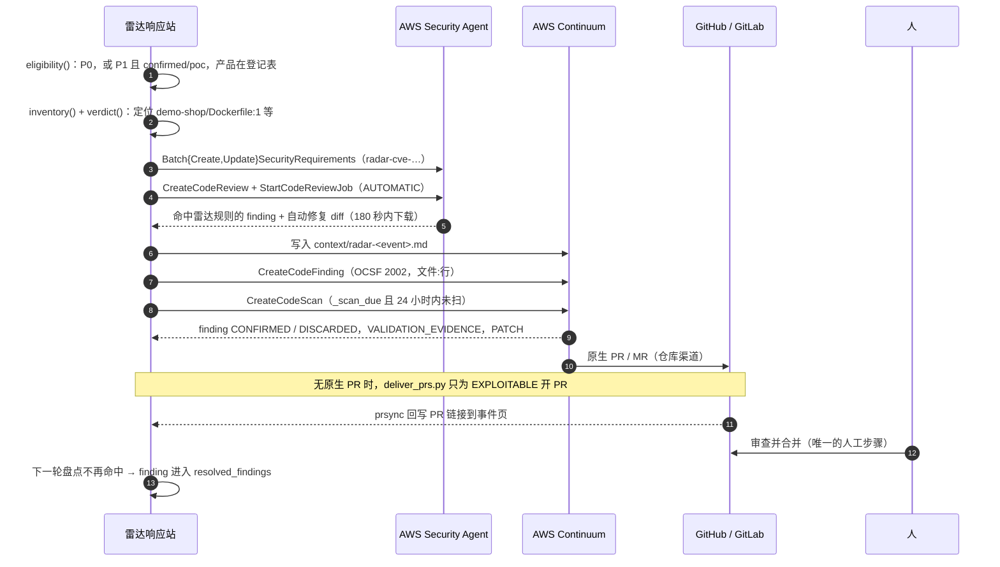

# 03 响应与缓解：从事件到代码行、补丁 PR 和边缘规则

本文读的是 [aws-samples/sample-security-radar](https://github.com/aws-samples/sample-security-radar) 在提交 `7d5362e` 的代码。前两篇讲雷达怎么收集、聚类和定级事件。本篇讲事件定级之后的两条路：

- **响应站（respond station）**：把事件落到你自己代码里的具体文件和行，交给 AWS Security Agent 做代码评审，交给 AWS Continuum 验证可利用性并生成补丁，最后以 GitHub 拉取请求（Pull Request，PR）或 GitLab 合并请求（Merge Request，MR）交给人合并。这条路是修复，要几小时到几天。
- **缓解站（mitigate station）**：在补丁合并之前，用 AWS WAF（Web 应用防火墙）托管规则和 Route 53 Resolver DNS Firewall（DNS 防火墙）降低暴露，用 Amazon Inspector 补查依赖包，再把结果导出到 AWS Security Hub。这条路不是修复。

文中路径都相对于源仓库根目录。链接前缀为 `https://github.com/aws-samples/sample-security-radar/blob/7d5362e/`。

## 1. 代码分层：纯逻辑与 AWS 适配器分开

响应站分成两层。`src/radar/respond.py` 是纯函数：不调 AWS，不读时钟。`decide` 把（事件、证据、状态、目标、预算）变成一组操作，`apply` 把操作结果折回状态，`to_response` 生成页面数据。`src/radar/continuum_aws.py` 只负责执行这些操作（[respond.py:1-7](https://github.com/aws-samples/sample-security-radar/blob/7d5362e/src/radar/respond.py#L1)）。

文件头写明了分工："何时扫描、推什么规则、受影响版本钉在哪里"由代码决定；"代码是否可利用、怎么修"由 AWS 的代理判断。

适配器从不因下游故障抛异常。每个操作的错误都变成 `{"error": ...}`，由 `apply` 记进状态，下一轮重试（[continuum_aws.py:177-182](https://github.com/aws-samples/sample-security-radar/blob/7d5362e/src/radar/continuum_aws.py#L177)）：

```python
def execute(op: respond.Op, ev: dict[str, Any], items: list[dict[str, Any]], st: dict[str, Any], env: dict[str, Any]) -> dict[str, Any]:
    try:
        return _EXEC[op.kind](op, ev, items, st, env)
    except (ClientError, BotoCoreError, OSError, KeyError, ValueError) as e:
        log.warning(json.dumps({"station": "respond", "op": op.kind, "event": ev["event_id"], "error": str(e)[:300]}))
        return _err(e)
```

缓解站同样分层：`src/radar/mitigate.py` 是纯逻辑，`src/radar/mitigate_aws.py` 是适配器，`src/radar/mitigate_station.py` 负责编排（[mitigate_station.py:1-7](https://github.com/aws-samples/sample-security-radar/blob/7d5362e/src/radar/mitigate_station.py#L1)）。测试里用假的 `aws` 对象替换适配器。

## 2. 资格门：哪些事件触发响应

`eligibility()` 决定响应站是否处理一个事件。每个"否"都带原因（[respond.py:92-121](https://github.com/aws-samples/sample-security-radar/blob/7d5362e/src/radar/respond.py#L92)）：

```python
sev, expl = ev["severity"], ev["exploitation"]
if ev["domain"] not in ("vuln", "web3"):
    return {"eligible": False, "reason": f"{ev['domain']} 事件不涉及代码依赖，不做代码侧响应"}
if not (sev == "P0" or (sev == "P1" and expl in ("confirmed", "poc"))):
    return {"eligible": False, "reason": f"{sev}/{expl}：只对 P0，或已利用/有 PoC 的 P1 做代码侧响应"}
...
prod = products.match(ev["title"], ev.get("entities") or [])
if not prod:
    return {"eligible": False, "reason": "产品不在登记表（网络设备/闭源产品不在代码里），无法定位代码"}
fixed, affected = products.versions(prod, tx)
```

规则归纳如下：

| 条件 | 结果 |
|---|---|
| 领域不是 `vuln`（漏洞）或 `web3` | 不处理 |
| 严重度是 P0 | 处理 |
| P1，且利用状态为 `confirmed`（已确认利用）或 `poc`（有概念验证代码） | 处理 |
| P1 且只是 `reported`（有报道称被利用），或 P2 | 不处理 |
| 漏洞事件的产品不在登记表 | 不处理（网络设备、闭源产品不在代码里） |
| Web3 事件既无登记的攻击手法，证据里也无地址类失陷指标（Indicator of Compromise，IOC） | 不处理 |

测试 `test_eligibility_says_why` 覆盖了这几条，并断言原因文本（[tests/test_respond.py:89-99](https://github.com/aws-samples/sample-security-radar/blob/7d5362e/tests/test_respond.py#L89)）。

不合格的事件仍会继续轮询已经在跑的任务（[respond.py:304-305](https://github.com/aws-samples/sample-security-radar/blob/7d5362e/src/radar/respond.py#L304)）。事件冷却后，页面保留之前的结果，并写明"已退出触发条件，不再发起新工作"（[respond.py:705-710](https://github.com/aws-samples/sample-security-radar/blob/7d5362e/src/radar/respond.py#L705)）。

付费代码评审的门槛比资格门更严：目标必须真的用到该产品，且事件为 P0 或利用状态为 `confirmed`（[respond.py:331-334](https://github.com/aws-samples/sample-security-radar/blob/7d5362e/src/radar/respond.py#L331)）。

## 3. 定位：产品登记表 → 文件:行

### 3.1 产品登记表

`src/radar/products.py` 是确定性登记表，不用大模型。一个条目回答三个问题：事件是否涉及该产品、证据说哪些版本已修复或受影响、目标代码在哪里钉了这个产品（[products.py:1-9](https://github.com/aws-samples/sample-security-radar/blob/7d5362e/src/radar/products.py#L1)）。PHP 的条目（[products.py:37-44](https://github.com/aws-samples/sample-security-radar/blob/7d5362e/src/radar/products.py#L37)）：

```python
Product("php", "PHP", r"\bPHP\b", ("PHP", "php"), (
    Locator("Dockerfile*", rf"^\s*FROM\s+{_IMG}php:(\d+\.\d+(?:\.\d+)?)", "runtime image"),
    Locator("*.yml", rf"image:\s*[\"']?{_IMG}php:(\d+\.\d+(?:\.\d+)?)", "CI image"),
    Locator("*.yaml", rf"image:\s*[\"']?{_IMG}php:(\d+\.\d+(?:\.\d+)?)", "CI image"),
    Locator("composer.json", r"\"php\"\s*:\s*\"(\d+\.\d+\.\d+)\"", "composer platform"),
    Locator(".tool-versions", r"^php\s+(\d+\.\d+\.\d+)", "tool-versions"),
    Locator("Dockerfile*", rf"^\s*FROM\s+{_IMG}wordpress:[\w.]*-php(\d+\.\d+)", "WordPress image PHP branch"),
)),
```

`_IMG` 允许镜像带仓库前缀，所以 `public.ecr.aws/docker/library/php:8.3.30-apache` 也能匹配（[products.py:34](https://github.com/aws-samples/sample-security-radar/blob/7d5362e/src/radar/products.py#L34)）。登记表还有 Node.js、Python、WordPress 等条目。OpenSSL、nginx、Struts 等只登记了名称，没有定位器，用来确定性地回答"不在我们代码里"（[products.py:61-70](https://github.com/aws-samples/sample-security-radar/blob/7d5362e/src/radar/products.py#L61)）。

### 3.2 从证据抽修复版本

`versions()` 在证据文本里找"产品名 + 版本列表"，再看版本前 80 个字符内最近的提示词。"update to""fixes are in""fixed in"等算修复版本，"ran on""affected""vulnerable"等算受影响版本。无法归类的版本直接丢弃（[products.py:74-107](https://github.com/aws-samples/sample-security-radar/blob/7d5362e/src/radar/products.py#L74)）。注释原话是：无法定位的版本不是可以行动的事实。

### 3.3 逐行盘点与版本比较

`inventory()` 遍历目标代码的每个文件，按文件名匹配定位器，逐行跑正则，产出 `Pin(product_id, version, file, line, kind)`（[products.py:126-139](https://github.com/aws-samples/sample-security-radar/blob/7d5362e/src/radar/products.py#L126)）。

`verdict()` 只在同一主次版本分支内比较（[products.py:146-158](https://github.com/aws-samples/sample-security-radar/blob/7d5362e/src/radar/products.py#L146)）：

```python
v = _parts(pin_version)
if len(v) < 3:
    return "unknown", None
if pin_version in affected:
    return "affected", next((f for f in fixed if _parts(f)[:2] == v[:2]), None)
for f in fixed:
    if _parts(f)[:2] == v[:2]:
        return ("affected" if v < _parts(f) else "fixed"), f
return "unknown", None
```

三种"无法比较"的情况都返回 `unknown`，不猜：

- 钉的版本不完整，例如 `8.3` 或 `24`。
- 分支不在修复列表里，例如 `8.1.2`（测试参数见 [tests/test_respond.py:75-80](https://github.com/aws-samples/sample-security-radar/blob/7d5362e/tests/test_respond.py#L75)）。
- 证据没给修复版本，也没点名这个版本。

只有 `affected` 才进入 `locations()`，并标记 `match: exact`（[respond.py:168-183](https://github.com/aws-samples/sample-security-radar/blob/7d5362e/src/radar/respond.py#L168)）。页面上，相关但没有精确命中、也没有评审结果的目标显示为 `unknown`，原因是"版本无法比较（未钉死），未发起评审"（[respond.py:734-735](https://github.com/aws-samples/sample-security-radar/blob/7d5362e/src/radar/respond.py#L734)）。

这里有一个分工：雷达自己无法比较时，判断交给 AI 评审。`relevant()` 只看目标是否用到该产品，不看版本能否比较（[respond.py:186-189](https://github.com/aws-samples/sample-security-radar/blob/7d5362e/src/radar/respond.py#L186)）。所以 `wp-storefront` 的 `wordpress:6.8.1-php8.3-apache` 只钉到 PHP 分支 `8.3`，雷达判 `unknown`，但 P0 事件仍会为它发起付费评审（`test_php2shell_reviews_every_php_target_including_wordpress_image`，[tests/test_respond.py:305-308](https://github.com/aws-samples/sample-security-radar/blob/7d5362e/tests/test_respond.py#L305)）。P1 事件则只盘点、不花钱（`test_p1_poc_with_partial_pins_checks_inventory_but_spends_nothing`，[tests/test_respond.py:184](https://github.com/aws-samples/sample-security-radar/blob/7d5362e/tests/test_respond.py#L184)）。

## 4. AWS Security Agent：规则包与代码评审

### 4.1 把事件写成一条安全规则

`requirement()` 把事件写成 Security Agent 规则包（requirement pack）里的一条规则。规则名由 CVE 编号拼成，满足接口约束 `[a-z0-9][a-z0-9-]*`、不超过 64 字符、不能有下划线（[respond.py:129-132](https://github.com/aws-samples/sample-security-radar/blob/7d5362e/src/radar/respond.py#L129)）。有修复版本时，评估文本是"任何低于本分支修复版本、或分支不在列表里的 PHP 都判失败"；没有修复版本时，改为"标出每处使用，交人评审"（[respond.py:150-165](https://github.com/aws-samples/sample-security-radar/blob/7d5362e/src/radar/respond.py#L150)）。

同步时先列出规则包里已有的名称，再选择批量创建或批量更新，按名称幂等（[continuum_aws.py:185-198](https://github.com/aws-samples/sample-security-radar/blob/7d5362e/src/radar/continuum_aws.py#L185)）。规则每天重新写入一次，因为规则包是 CloudFormation 资源，栈更新可能悄悄丢掉规则（[respond.py:309-311](https://github.com/aws-samples/sample-security-radar/blob/7d5362e/src/radar/respond.py#L309)）。

过期规则由 `prune_plan()` 清理：只看 `radar-` 前缀的规则，超过保留天数没有被重新写入就删除，其他人的规则从不碰（[respond.py:367-377](https://github.com/aws-samples/sample-security-radar/blob/7d5362e/src/radar/respond.py#L367)）。

### 4.2 发起评审和读取结果

`_start_review()` 用 `codeRemediationStrategy="AUTOMATIC"` 创建评审并启动任务（[continuum_aws.py:263-272](https://github.com/aws-samples/sample-security-radar/blob/7d5362e/src/radar/continuum_aws.py#L263)）。代码来源默认是 S3 里的 zip。GitLab 渠道的目标改用已集成的 gitlab.com 仓库，这样自动修复会直接开 MR（[continuum_aws.py:253-260](https://github.com/aws-samples/sample-security-radar/blob/7d5362e/src/radar/continuum_aws.py#L253)）。

费用控制有三层：

- 一次评审会评估规则包里的全部规则。`plan_reviews()` 按目标合并请求，同一仓库上的 N 个事件只花一次评审（[respond.py:413-427](https://github.com/aws-samples/sample-security-radar/blob/7d5362e/src/radar/respond.py#L413)）。
- 每天最多 6 次评审，`Limits.SA_REVIEWS_PER_DAY = 6`（[limits.py:60](https://github.com/aws-samples/sample-security-radar/blob/7d5362e/src/radar/limits.py#L60)）。额度用完时，`block_review()` 在页面上写明原因（[respond.py:430-433](https://github.com/aws-samples/sample-security-radar/blob/7d5362e/src/radar/respond.py#L430)）。
- 只有事件升级时才重新评审。触发键由严重度、可信度等级和利用状态拼成（[respond.py:290-292](https://github.com/aws-samples/sample-security-radar/blob/7d5362e/src/radar/respond.py#L290)）。

`_poll_review()` 在任务结束后拉取全部 finding（发现项）。标题以 `[Requirement: …/radar-` 开头的，算命中雷达规则（[respond.py:27-32](https://github.com/aws-samples/sample-security-radar/blob/7d5362e/src/radar/respond.py#L27)）。自动修复的 diff 链接是预签名链接，180 秒内有效，所以读到就立刻下载并存到站点桶（[continuum_aws.py:296-300](https://github.com/aws-samples/sample-security-radar/blob/7d5362e/src/radar/continuum_aws.py#L296)）。下载只接受 `https://…amazonaws.com/` 链接（[continuum_aws.py:304-306](https://github.com/aws-samples/sample-security-radar/blob/7d5362e/src/radar/continuum_aws.py#L304)）。读取逻辑改变时，提高 `REVIEW_PARSER` 版本号，已完成的评审会被重读一次（[respond.py:25](https://github.com/aws-samples/sample-security-radar/blob/7d5362e/src/radar/respond.py#L25)）。

`integrations/continuum/poc.py` 是最早的手工验证脚本，包含 setup、run、status、teardown 四步。它把演示仓库打成 zip，创建规则包，用同一个 `respond.requirement()` 生成规则，再发起评审（[poc.py:89-94](https://github.com/aws-samples/sample-security-radar/blob/7d5362e/integrations/continuum/poc.py#L89)，[poc.py:101-119](https://github.com/aws-samples/sample-security-radar/blob/7d5362e/integrations/continuum/poc.py#L101)）。teardown 按依赖倒序删除，跳过的步骤会打印出来（[poc.py:132-153](https://github.com/aws-samples/sample-security-radar/blob/7d5362e/integrations/continuum/poc.py#L132)）。

## 5. AWS Continuum：验证、扫描、补丁

Continuum 运行在 us-east-1，东京区域没有端点（[continuum_aws.py:1-3](https://github.com/aws-samples/sample-security-radar/blob/7d5362e/src/radar/continuum_aws.py#L1)）。

### 5.1 环境和集成按名称对账

Continuum 的环境（environment）没有 CloudFormation 资源类型，所以 `ensure_environment()` 每轮"按名称查找，没有就创建"（[continuum_aws.py:98-140](https://github.com/aws-samples/sample-security-radar/blob/7d5362e/src/radar/continuum_aws.py#L98)）。实测约束写在注释里：每个环境只能有一个 S3 源，每个 zip 算一个仓库，每个环境最多 10 个仓库（[continuum_aws.py:111-115](https://github.com/aws-samples/sample-security-radar/blob/7d5362e/src/radar/continuum_aws.py#L111)）。

对账也包括扫描计划。环境被统一设为 `PT0H`（不定时扫描），扫描只由雷达触发。原因是早期用 `P7D` 创建的环境一直在每周跑一次付费扫描（[continuum_aws.py:120-126](https://github.com/aws-samples/sample-security-radar/blob/7d5362e/src/radar/continuum_aws.py#L120)，[limits.py:62](https://github.com/aws-samples/sample-security-radar/blob/7d5362e/src/radar/limits.py#L62)）。

GitHub 和 GitLab 的集成在带外创建：GitHub 要一次浏览器授权，GitLab 用 `scripts/sync-fleet.py` 加访问令牌创建，令牌只交给 Continuum，不进 Lambda。Lambda 只按名称 `<env>-<channel>` 找到集成，再维护一个 `PT0H` 环境（[continuum_aws.py:143-172](https://github.com/aws-samples/sample-security-radar/blob/7d5362e/src/radar/continuum_aws.py#L143)）。一个仓库渠道出错不会拖垮其他渠道（[continuum_aws.py:134-139](https://github.com/aws-samples/sample-security-radar/blob/7d5362e/src/radar/continuum_aws.py#L134)）。

### 5.2 知识上下文

`context_doc()` 把事件写成 markdown：事件编号、等级、CVE、来源，加上分析卡里**通过校验**（grounded）的句子，再加证据链接（[respond.py:192-206](https://github.com/aws-samples/sample-security-radar/blob/7d5362e/src/radar/respond.py#L192)）。文档写到 Continuum 桶的 `context/radar-<event_id>.md`，内容哈希变了才重写（[respond.py:312-314](https://github.com/aws-samples/sample-security-radar/blob/7d5362e/src/radar/respond.py#L312)，[continuum_aws.py:220-223](https://github.com/aws-samples/sample-security-radar/blob/7d5362e/src/radar/continuum_aws.py#L220)）。

### 5.3 OCSF 2002 finding

雷达把每个精确命中的代码位置提交成一条 OCSF（Open Cybersecurity Schema Framework，开放网络安全模式框架）1.9 漏洞发现（Vulnerability Finding，class 2002）。字段集是 Continuum 校验器实测要求的：`metadata.version`、`cloud`、`osint`、`finding_info.uid`、`vulnerabilities[0].affected_code[0].file`（[respond.py:209-248](https://github.com/aws-samples/sample-security-radar/blob/7d5362e/src/radar/respond.py#L209)）。

下面是对 PHP2Shell 测试夹具（`tests/fixtures/events/php2shell.json`）在 `demo-shop/Dockerfile:1` 上运行 `respond.ocsf()` 的输出，删掉了部分字段，`osint` 只留一条：

```json
{
  "class_uid": 2002, "category_uid": 2, "type_uid": 200201, "activity_id": 1,
  "severity_id": 5, "status_id": 1,
  "cloud": {"provider": "AWS", "region": "us-east-1"},
  "osint": [{"type_id": 5, "value": "https://fortiguard.fortinet.com/psirt/FG-IR-26-186", "name": "Fortinet PSIRT"}],
  "metadata": {"version": "1.9.0", "product": {"name": "Security Radar", "vendor_name": "aws-gcr-web3"}},
  "finding_info": {"uid": "radar-ev_bb65db3b8694e5f4-b15320bcce5e7eab",
                   "title": "PHP · 8.3.30 @ demo-shop/Dockerfile:1 · PHP core RCE vulnerability patches (…)"},
  "vulnerabilities": [{
    "cve": {"uid": "CVE-2026-109618"}, "severity": "Critical",
    "affected_code": [{"file": {"name": "Dockerfile", "path": "demo-shop/Dockerfile", "type_id": 1},
                       "start_line": 1, "end_line": 1}],
    "affected_packages": [{"name": "php", "version": "8.3.30", "fixed_in_version": "8.3.36"}],
    "remediation": {"desc": "Upgrade to PHP 8.3.36."}
  }]
}
```

有两个标识符要区分：

- `finding_uid()` 由（事件、文件、行、版本）哈希得到，代表同一处暴露（[respond.py:261-263](https://github.com/aws-samples/sample-security-radar/blob/7d5362e/src/radar/respond.py#L261)）。
- `client_token()` 是幂等令牌，按文档**内容**哈希，排除时间戳。原因是 Continuum 会把令牌保留 8 小时，即使请求被拒；修正后的文档如果复用旧令牌，会返回 `ConflictException`（[respond.py:251-258](https://github.com/aws-samples/sample-security-radar/blob/7d5362e/src/radar/respond.py#L251)）。

### 5.4 代码仓库渠道 REPO_CHANNELS

除了 S3 环境，雷达还支持代码托管平台上的环境，补丁可以原生交付成 PR 或 MR（[respond.py:47-55](https://github.com/aws-samples/sample-security-radar/blob/7d5362e/src/radar/respond.py#L47)）：

```python
REPO_CHANNELS = {"github": {"op": "gh", "label": "GitHub", "change": "PR", "web": "https://github.com", "tree": "tree"},
                 "gitlab": {"op": "gl", "label": "GitLab", "change": "MR", "web": "https://gitlab.com", "tree": "-/tree"}}
SCAN_OPS = {"s3": "request_scan", **{ch: f"request_scan_{m['op']}" for ch, m in REPO_CHANNELS.items()}}
CONTINUUM_OPS = frozenset({"write_context", "submit_finding", "request_scan", "poll_continuum"} | {
    f"{k}_{m['op']}" for m in REPO_CHANNELS.values() for k in ("submit_finding", "request_scan", "poll_continuum")})
```

操作名由表推导出来，不手写。测试 `test_every_op_respond_can_emit_has_an_executor` 检查每个操作都有执行器（[tests/test_channels.py:52](https://github.com/aws-samples/sample-security-radar/blob/7d5362e/tests/test_channels.py#L52)）。适配器侧，仓库渠道的提交、扫描、轮询就是 S3 操作指向另一个环境（[continuum_aws.py:390-405](https://github.com/aws-samples/sample-security-radar/blob/7d5362e/src/radar/continuum_aws.py#L390)）。

每个目标只属于一个环境，由 `targets.CHANNEL` 决定。同一份代码放进两个环境，会被验证和扫描两次，费用翻倍（[targets.py:19-28](https://github.com/aws-samples/sample-security-radar/blob/7d5362e/src/radar/targets.py#L19)，`Budget.channel()` 见 [respond.py:70-76](https://github.com/aws-samples/sample-security-radar/blob/7d5362e/src/radar/respond.py#L70)）。演示配置是：`demo-shop`、`node-gateway` 走 GitHub，`wp-storefront` 走 S3，`alps-vault` 走 GitLab，雷达自身仓库不送 Continuum。

### 5.5 扫描护栏

一个提交上去的 finding，要等下一次成功构建才会被验证。环境不定时扫描，所以雷达要自己触发扫描。`_scan_due()` 是所有渠道共用的唯一规则（[respond.py:398-410](https://github.com/aws-samples/sample-security-radar/blob/7d5362e/src/radar/respond.py#L398)）：

```python
scan = scan or {}
last_req = scan.get("requested_at") or ""
waiting = any(f.get("status") == "SUBMITTED" and f.get("submitted_at", "") > last_req for f in findings)
return waiting and (not scan or scan.get("status") in TERMINAL_SCAN)
```

docstring 记录了每条约束背后的实际费用事故：

- 只看**已提交成功**的 finding，不看"发出了提交操作"。`CreateCodeFinding` 被禁用的那段时间，每轮都重发提交，每次都像新的，于是每 6 小时跑一次全量付费扫描，约 1.4 千美元/天。
- 不设"P0 还没扫过就扫"的触发。这种触发曾为代码里根本没定位到的事件扫描，一次约 450 美元。

其他护栏：

- 每轮每个环境最多一次扫描（[respond.py:357](https://github.com/aws-samples/sample-security-radar/blob/7d5362e/src/radar/respond.py#L357)，[respond.py:359-363](https://github.com/aws-samples/sample-security-radar/blob/7d5362e/src/radar/respond.py#L359)）。
- 每个环境 24 小时最多一次付费扫描（[handlers.py:207-210](https://github.com/aws-samples/sample-security-radar/blob/7d5362e/src/radar/handlers.py#L207)，[limits.py:70](https://github.com/aws-samples/sample-security-radar/blob/7d5362e/src/radar/limits.py#L70)）。注意：覆盖率登记表里这一行仍写"6 小时去抖"（[coverage.py:34](https://github.com/aws-samples/sample-security-radar/blob/7d5362e/src/radar/coverage.py#L34)），和 `Limits` 不一致，以 `Limits` 为准。
- 扫描幂等令牌随"待验证 finding 集合"变化。按事件固定的令牌会让重扫请求回放第一次扫描，什么都没跑（[respond.py:266-272](https://github.com/aws-samples/sample-security-radar/blob/7d5362e/src/radar/respond.py#L266)）。
- 每个环境同一时间只能跑一个扫描。收到 `ServiceQuotaExceededException` 时，复用正在跑的那个（[continuum_aws.py:237-250](https://github.com/aws-samples/sample-security-radar/blob/7d5362e/src/radar/continuum_aws.py#L237)）。
- 创建扫描时如果直接返回一个已结束的扫描，要映射成 done 或 failed，否则事件会永远停在 running（[respond.py:284-287](https://github.com/aws-samples/sample-security-radar/blob/7d5362e/src/radar/respond.py#L284)）。

### 5.6 取回验证结论

`_read_env()` 读取一个环境里属于雷达的 finding、它们关联的 issue（问题单）、验证证据和补丁（[continuum_aws.py:315-368](https://github.com/aws-samples/sample-security-radar/blob/7d5362e/src/radar/continuum_aws.py#L315)）：

- finding 进入 `CONFIRMED` 或 `DISCARDED` 后，结论取自 `validation.verdict`、`discardReason` 或终态本身。客户提交的 finding 没有 validation 块，这是实测结果（[continuum_aws.py:324-330](https://github.com/aws-samples/sample-security-radar/blob/7d5362e/src/radar/continuum_aws.py#L324)）。
- `VALIDATION_EVIDENCE` 工件给出 `exploitable`、观察到的效果和源码分析摘要（[continuum_aws.py:345-352](https://github.com/aws-samples/sample-security-radar/blob/7d5362e/src/radar/continuum_aws.py#L345)）。
- `PATCH` 工件里的统一 diff 存到站点桶。投递目标里有 GitHub PR 编号就拼出 PR 链接，GitLab 用 `_gitlab_mr_url()` 拼 MR 链接（[continuum_aws.py:353-364](https://github.com/aws-samples/sample-security-radar/blob/7d5362e/src/radar/continuum_aws.py#L353)，[continuum_aws.py:376-387](https://github.com/aws-samples/sample-security-radar/blob/7d5362e/src/radar/continuum_aws.py#L376)）。botocore 1.43.118 的模型里没有 `gitlab` 成员，所以适配器保留原始响应体，从里面读（[continuum_aws.py:45-63](https://github.com/aws-samples/sample-security-radar/blob/7d5362e/src/radar/continuum_aws.py#L45)）。

Continuum 没有更新 finding 或 issue 的接口。代码里某处暴露消失后，雷达自己把 finding 移到 `resolved_findings`，作为修复证据（[respond.py:385-396](https://github.com/aws-samples/sample-security-radar/blob/7d5362e/src/radar/respond.py#L385)）。键会漂移，行号也会漂移（例如 Dockerfile 上方加一行，`:1` 变成 `:2`）。`_rekey_by_location()` 按（文件、行）重新对上键；行号变了的，只有在同一文件里恰好有一个同版本的空闲位置时才改指向，有歧义就不猜（[respond.py:436-470](https://github.com/aws-samples/sample-security-radar/blob/7d5362e/src/radar/respond.py#L436)）。轮询只覆盖活跃 finding，所以 issue 列表是合并，不是替换（[respond.py:473-477](https://github.com/aws-samples/sample-security-radar/blob/7d5362e/src/radar/respond.py#L473)）。

### 5.7 PR / MR 交付

接通 GitHub 或 GitLab 环境后，Continuum 原生开 PR 或 MR，`apply()` 把链接写进事件动作（[respond.py:659-664](https://github.com/aws-samples/sample-security-radar/blob/7d5362e/src/radar/respond.py#L659)）。

在 GitHub 源还不可用的阶段，`scripts/deliver_prs.py` 负责兜底交付（[scripts/deliver_prs.py:1-15](https://github.com/aws-samples/sample-security-radar/blob/7d5362e/scripts/deliver_prs.py#L1)）：

- 只交付 Continuum 判为 `EXPLOITABLE` 且有补丁的 issue（[deliver_prs.py:75](https://github.com/aws-samples/sample-security-radar/blob/7d5362e/scripts/deliver_prs.py#L75)）。
- 每个（事件、目标）只开一个 PR，保留覆盖文件最多的补丁。已有原生 PR 的就跳过（[deliver_prs.py:65-91](https://github.com/aws-samples/sample-security-radar/blob/7d5362e/scripts/deliver_prs.py#L65)）。
- `target_of()` 要求补丁的每个文件、每行上下文都在某个目标里存在，并且只有一个目标匹配。只按文件名匹配会出错：每个目标都有 Dockerfile，曾经有一个 Node.js 的 Dockerfile 补丁被配到了 demo-shop（[deliver_prs.py:112-126](https://github.com/aws-samples/sample-security-radar/blob/7d5362e/scripts/deliver_prs.py#L112)）。
- PR 正文第一行写 Continuum issue 编号，正文明说合并前要人工审查（[deliver_prs.py:129-140](https://github.com/aws-samples/sample-security-radar/blob/7d5362e/scripts/deliver_prs.py#L129)）。

这个脚本只读站点、只写 GitHub，不持有 AWS 凭证。PR 链接回流到事件页由 `src/radar/prsync.py` 负责。它是唯一的写入者，用只读的单仓库令牌，按分支名 `continuum/<事件前缀>-` 和正文里的 issue 编号匹配（[prsync.py:14-25](https://github.com/aws-samples/sample-security-radar/blob/7d5362e/src/radar/prsync.py#L14)，[handlers.py:321-332](https://github.com/aws-samples/sample-security-radar/blob/7d5362e/src/radar/handlers.py#L321)）。

演示目标的唯一来源是 `integrations/continuum/targets/`。`scripts/sync-fleet.py` 把每个渠道的目标镜像到对应代码托管平台，镜像整体覆盖，不合并（[scripts/sync-fleet.py:1-18](https://github.com/aws-samples/sample-security-radar/blob/7d5362e/scripts/sync-fleet.py#L1)）。舰队仓库的 README 写明：合并 Continuum 的 PR 是整个循环里唯一的人工步骤（[integrations/continuum/fleet-README.md:18](https://github.com/aws-samples/sample-security-radar/blob/7d5362e/integrations/continuum/fleet-README.md#L18)）。

### 5.8 时序图



## 6. Amazon Inspector ScanSbom：锁文件依赖与运行时盲区

`src/radar/inspector.py` 文件头记录了一次实测（2026-10-29）：Inspector 的 ScanSbom 只判断**语言包**。`pkg:generic/php`、`pkg:generic/node`、WordPress 和 Debian 的软件包标识（purl）返回 0 条结果；pypi 和 npm 返回已知 CVE（[inspector.py:1-11](https://github.com/aws-samples/sample-security-radar/blob/7d5362e/src/radar/inspector.py#L1)）。

所以分工是：运行时版本由雷达的产品登记表判断，锁文件里的包交给 Inspector 判断。

- 读取器覆盖 `uv.lock`、`package-lock.json`、`composer.lock`、`requirements.txt` 和 `package.json`。`package.json` 只读精确版本，并且同目录有 `package-lock.json` 时不读（[inspector.py:42-61](https://github.com/aws-samples/sample-security-radar/blob/7d5362e/src/radar/inspector.py#L42)，[inspector.py:64-80](https://github.com/aws-samples/sample-security-radar/blob/7d5362e/src/radar/inspector.py#L64)）。
- `sbom()` 生成 CycloneDX 1.5 软件物料清单（Software Bill of Materials，SBOM），每个精确版本一个组件（[inspector.py:83-87](https://github.com/aws-samples/sample-security-radar/blob/7d5362e/src/radar/inspector.py#L83)）。
- `findings()` 解析返回结果。修复版本按组件放在属性 `amazon:inspector:sbom_scanner:fixed_version:<ref>` 里（[inspector.py:90-104](https://github.com/aws-samples/sample-security-radar/blob/7d5362e/src/radar/inspector.py#L90)）。
- ScanSbom 是无状态调用，账号里不需要启用任何东西，每次 0.03 美元（[mitigate_aws.py:42-51](https://github.com/aws-samples/sample-security-radar/blob/7d5362e/src/radar/mitigate_aws.py#L42)）。每天最多 5 次（[limits.py:68](https://github.com/aws-samples/sample-security-radar/blob/7d5362e/src/radar/limits.py#L68)）。

盲区要明确记录：没有锁文件的目标记为 `no_packages`，不记为"干净"（[mitigate_station.py:72-74](https://github.com/aws-samples/sample-security-radar/blob/7d5362e/src/radar/mitigate_station.py#L72)）。在 `ui/mock-data/data/mitigate.json` 里，`demo-shop` 的 Inspector 状态就是 `no_packages`、0 个组件。它的 PHP 8.3.30 只钉在 Dockerfile、CI 镜像和 composer platform 里，Inspector 看不到。

## 7. AWS WAF：虚拟补丁

### 7.1 三档方案

`mitigate.py` 文件头定义了三档，越具体越优先（[mitigate.py:13-18](https://github.com/aws-samples/sample-security-radar/blob/7d5362e/src/radar/mitigate.py#L13)）：

| 档位 | 来源 | 是否自动应用 |
|---|---|---|
| `cve` | AWS 托管规则更新日志点名该 CVE，给出规则名和最低静态版本 | 是（Count） |
| `product` | 定位到的产品有专用规则组：PHP → `AWSManagedRulesPHPRuleSet`，WordPress → `AWSManagedRulesWordPressRuleSet` | 是（整组 Count） |
| `cwe` | CVE 的弱点类型（Common Weakness Enumeration，CWE）有通用规则族，如 SQL 注入、路径穿越、SSRF | 否，只作建议 |

`cwe` 档不自动应用，因为通用签名对具体 CVE 只是提示，不是虚拟补丁（`APPLY_TIERS`，[mitigate.py:30-31](https://github.com/aws-samples/sample-security-radar/blob/7d5362e/src/radar/mitigate.py#L30)）。只有判定为 `affected` 的目标才有方案（[mitigate.py:198-200](https://github.com/aws-samples/sample-security-radar/blob/7d5362e/src/radar/mitigate.py#L198)）。

### 7.2 从更新日志建目录

`parse_waf_changelog()` 解析 [AWS 托管规则更新日志](https://docs.aws.amazon.com/waf/latest/developerguide/aws-managed-rule-groups-changelog.html)。规则组只取第一格里的链接，因为描述格可能顺带链接其他规则组：2026-10-21 PHP 2.3 那一行就把 CVE-2026-109618 指向了 Core rule set（[mitigate.py:105-123](https://github.com/aws-samples/sample-security-radar/blob/7d5362e/src/radar/mitigate.py#L105)）。

`waf_catalog()` 对每个（CVE、规则组）取点名该 CVE 的**最新**静态版本作为最低版本，不取第一次提到的版本。第一次提到可能只是提到，真正能检测是在后面的版本（[mitigate.py:140-154](https://github.com/aws-samples/sample-security-radar/blob/7d5362e/src/radar/mitigate.py#L140)）。

### 7.3 先 Count，再由人提升为 Block

`waf_rule()` 是唯一的规则渲染器，页面、PR 文本和实际应用都用它。暂存状态下，具名规则被覆盖为 Count；方案没列规则时整组 Count。规则组用默认版本，因为 AWS 推荐默认版本，`waf_check()` 再检查默认版本是否够新（[mitigate.py:236-251](https://github.com/aws-samples/sample-security-radar/blob/7d5362e/src/radar/mitigate.py#L236)）。

提升为 Block 是人工步骤，由 `scripts/promote.py` 记录。必须带 `--by <name>`，记下是谁决定的；`--revoke` 撤回到 Count。脚本只写 DynamoDB 里的 `__mitigate_promotions__`，缓解站下一轮应用，并且从不自行降级（[scripts/promote.py:1-11](https://github.com/aws-samples/sample-security-radar/blob/7d5362e/scripts/promote.py#L1)，[scripts/promote.py:78-88](https://github.com/aws-samples/sample-security-radar/blob/7d5362e/scripts/promote.py#L78)）。没有可应用方案的规则组不能提升（[scripts/promote.py:73-77](https://github.com/aws-samples/sample-security-radar/blob/7d5362e/scripts/promote.py#L73)）。

`scripts/waf-e2e.py` 做端到端验证：发一个形状符合 AWS 文档描述、但本身无害的请求，Count 模式下应放行到 401 鉴权门，Block 模式下应返回 403，再在 `GetSampledRequests` 里找到对应标签（[scripts/waf-e2e.py:1-11](https://github.com/aws-samples/sample-security-radar/blob/7d5362e/scripts/waf-e2e.py#L1)）。

### 7.4 只读防护审计的五种状态

`waf_check()` 只读 `GetWebACL` 返回的规则描述，给出方案在 web ACL 上的状态（[mitigate.py:255-283](https://github.com/aws-samples/sample-security-radar/blob/7d5362e/src/radar/mitigate.py#L255)）：

| 状态 | 含义 |
|---|---|
| `absent` | web ACL 里没有这个规则组 |
| `too_old` | 固定版本或默认版本低于方案要求的最低版本，CVE 规则不在里面 |
| `group_counted` | 整组被覆盖为 Count，什么都不拦（AWS 文档提醒要确认没有这样覆盖） |
| `staged` | 规则组存在，方案里的规则在 Count，等人确认 |
| `blocking` | 规则组存在，方案里的规则生效（Block） |

另外两种状态由编排层给出：目标前面没有登记 web ACL 时是 `no_web_acl`，读取失败时是 `unchecked`。"没查"不会显示成"查过、无事"（[mitigate_station.py:214-219](https://github.com/aws-samples/sample-security-radar/blob/7d5362e/src/radar/mitigate_station.py#L214)）。

## 8. DNS Firewall：只用去毒化写法的域名

域名 IOC 只认去毒化（defang）写法，例如 `evil[.]com`、`hxxps://`。安全作者用这种写法标记恶意指标；文章里普通写法的域名多半是来源、厂商或受害者，放进阻断列表会切断正常服务。注释里的实测数据是：343 个线上事件里有 0 个去毒化域名，门槛是故意设高的（[patterns.py:93-118](https://github.com/aws-samples/sample-security-radar/blob/7d5362e/src/radar/patterns.py#L93)）：

```python
NEVER_BLOCK = ("amazonaws.com", "amazon.com", "aws.amazon.com", "cloudfront.net", "github.com", "githubusercontent.com",
               "google.com", "googleapis.com", "microsoft.com", "windows.net", "azure.com", "apple.com", "cloudflare.com",
               "npmjs.org", "npmjs.com", "pypi.org", "etherscan.io", "bscscan.com", "x.com", "twitter.com", "t.me", "telegram.org")
...
            if not _DEFANGED.search(raw):
                continue
            d = re.sub(r"(?i)\[\.\]|\(\.\)|\[dot\]|\(dot\)|\{\.\}", ".", m.group(1)).lower().strip(".")
            if "." not in d or any(d == n or d.endswith("." + n) for n in NEVER_BLOCK):
                continue
```

`NEVER_BLOCK` 里的域名及其子域名，无论文章怎么说都不进列表。

雷达只拥有一个域名列表和一个规则组。规则组包含雷达列表和 5 个 AWS 托管威胁列表，全部为 ALERT（只告警），只有人工提升后才改为 BLOCK，阻断时返回 NXDOMAIN（[mitigate.py:315-341](https://github.com/aws-samples/sample-security-radar/blob/7d5362e/src/radar/mitigate.py#L315)）。列表里总有一个金丝雀域名 `radar-canary.security-radar.invalid`，`scripts/dns-e2e.py` 从演示 VPC 解析它，再在 Resolver 查询日志里确认动作（[scripts/dns-e2e.py:1-8](https://github.com/aws-samples/sample-security-radar/blob/7d5362e/scripts/dns-e2e.py#L1)）。

## 9. Security Hub：ASFF 导出

每个（事件 × 受影响目标）生成一条 ASFF（AWS Security Finding Format）finding。内容包括修复版本、每处定位，以及各缓解渠道的当前状态，所以只看 Security Hub 的运维人员也能看到完整链路（[securityhub.py:1-6](https://github.com/aws-samples/sample-security-radar/blob/7d5362e/src/radar/securityhub.py#L1)，[securityhub.py:23-51](https://github.com/aws-samples/sample-security-radar/blob/7d5362e/src/radar/securityhub.py#L23)）。修复建议里固定写着"Mitigation is not a fix"（[securityhub.py:32-33](https://github.com/aws-samples/sample-security-radar/blob/7d5362e/src/radar/securityhub.py#L32)）。

`plan()` 按不含时间戳的内容哈希决定是否重新导入，因为超过每月 1 万条的导入要收费。不再受影响的组合会被导入为 `ARCHIVED`，只导入一次（[securityhub.py:54-85](https://github.com/aws-samples/sample-security-radar/blob/7d5362e/src/radar/securityhub.py#L54)）。导入失败时，账本保持上一轮的内容，下一轮重试同一批（[mitigate_station.py:131-138](https://github.com/aws-samples/sample-security-radar/blob/7d5362e/src/radar/mitigate_station.py#L131)）。

## 10. 只写雷达自己创建的资源

这条原则在多处代码里重复出现：

- **WAF**：IAM 只允许对名称以 `security-radar-` 开头的 web ACL 调用 `UpdateWebACL`（[infra/stack.py:187](https://github.com/aws-samples/sample-security-radar/blob/7d5362e/infra/stack.py#L187)）。适配器写之前再检查一次前缀（[mitigate_aws.py:97-100](https://github.com/aws-samples/sample-security-radar/blob/7d5362e/src/radar/mitigate_aws.py#L97)）。`merge_acl_rules()` 只写 `radar-*` 规则，其他规则逐字节保留；从不删除规则，缓解措施在打补丁后作为辅助控制保留，由人移除（[mitigate.py:291-312](https://github.com/aws-samples/sample-security-radar/blob/7d5362e/src/radar/mitigate.py#L291)）。别人已经在同一个 web ACL 里用了某个规则组时，雷达只报告，不重复添加（[mitigate_station.py:190-193](https://github.com/aws-samples/sample-security-radar/blob/7d5362e/src/radar/mitigate_station.py#L190)）。
- **DNS Firewall**：`dns_diff()` 只创建或更新雷达命名的规则，不删除任何规则（[mitigate.py:344-357](https://github.com/aws-samples/sample-security-radar/blob/7d5362e/src/radar/mitigate.py#L344)）。
- **Security Agent 规则包**：只清理 `radar-` 前缀的规则（[respond.py:374](https://github.com/aws-samples/sample-security-radar/blob/7d5362e/src/radar/respond.py#L374)）。
- **Continuum**：只轮询自己提交的 finding（`mine` 集合，[continuum_aws.py:371-373](https://github.com/aws-samples/sample-security-radar/blob/7d5362e/src/radar/continuum_aws.py#L371)）。环境和集成按雷达自己的名称查找。

测试 `test_merge_promotes_in_place_and_never_touches_foreign_rules` 和 `test_dns_diff_creates_updates_and_never_touches_foreign_rules` 锁定了这些行为（[tests/test_mitigate.py:147](https://github.com/aws-samples/sample-security-radar/blob/7d5362e/tests/test_mitigate.py#L147)，[tests/test_mitigate.py:179](https://github.com/aws-samples/sample-security-radar/blob/7d5362e/tests/test_mitigate.py#L179)）。

## 11. 本地测试结果

在本地以只读方式运行了本篇涉及的测试，没有部署任何 AWS 资源：

```
cd sample-security-radar && uv run pytest -q tests/test_respond.py tests/test_respond_station.py \
  tests/test_mitigate.py tests/test_mitigate_aws.py tests/test_mitigate_station.py tests/test_inspector.py \
  tests/test_channels.py tests/test_prsync.py tests/test_securityhub.py
132 passed, 1 skipped in 1.46s
```

跳过的一项是 `tests/test_mitigate.py:123`，它要对真实 AWS 检查 WAF 容量（需要 `RADAR_LIVE=1`）。本次按要求不连接 AWS，所以没有运行。

## 可复用模式

1. **纯决策函数 + 薄执行器**
   - 问题：调用云服务的流程很难测试，故障时容易半途抛异常，状态也不完整。
   - 做法：`decide(状态, 输入) → (新状态, 操作列表)` 和 `apply(状态, 操作, 结果)` 都写成纯函数；执行器只执行操作，把错误作为数据返回。测试时直接喂假结果。
   - 代码位置：`src/radar/respond.py` 的 `decide` / `apply`（[L297](https://github.com/aws-samples/sample-security-radar/blob/7d5362e/src/radar/respond.py#L297)，[L569](https://github.com/aws-samples/sample-security-radar/blob/7d5362e/src/radar/respond.py#L569)）；`src/radar/continuum_aws.py` 的 `execute`（[L177](https://github.com/aws-samples/sample-security-radar/blob/7d5362e/src/radar/continuum_aws.py#L177)）。

2. **登记表驱动的版本定位，无法比较就明说**
   - 问题：用大模型或宽松比较判断"是否受影响"，会给出看似确定的错误结论。
   - 做法：每个产品一个登记条目（标题正则、版本前的提示词、文件名加行正则）。只在同一主次版本分支内比较；版本不完整或分支未列出时返回 `unknown`，并把判断交给下一层评审。
   - 代码位置：`src/radar/products.py` 的 `PRODUCTS`、`versions`、`verdict`（[L36](https://github.com/aws-samples/sample-security-radar/blob/7d5362e/src/radar/products.py#L36)，[L146](https://github.com/aws-samples/sample-security-radar/blob/7d5362e/src/radar/products.py#L146)）。

3. **按结果触发付费操作，不按意图触发**
   - 问题：重试或下游被禁用时，"发出了请求"每轮都像新的，付费扫描被反复触发。
   - 做法：只有"上次扫描之后成功提交、仍待验证"的项目才触发扫描，并且上次扫描已结束；幂等令牌随待验证集合变化；再叠加每个环境的时间窗口。
   - 代码位置：`src/radar/respond.py` 的 `_scan_due`、`scan_token`（[L398](https://github.com/aws-samples/sample-security-radar/blob/7d5362e/src/radar/respond.py#L398)，[L266](https://github.com/aws-samples/sample-security-radar/blob/7d5362e/src/radar/respond.py#L266)）；`src/radar/handlers.py` 的 `_scan_open`（[L207](https://github.com/aws-samples/sample-security-radar/blob/7d5362e/src/radar/handlers.py#L207)）。

4. **按内容哈希生成幂等令牌**
   - 问题：服务在请求被拒后仍保留令牌，修正后的文档复用旧令牌会冲突；令牌带时间戳又失去幂等性。
   - 做法：令牌 = 稳定标识 + 去掉时间戳后的内容哈希。同一内容的重试幂等，内容改了就是新请求。
   - 代码位置：`src/radar/respond.py` 的 `client_token`（[L251](https://github.com/aws-samples/sample-security-radar/blob/7d5362e/src/radar/respond.py#L251)）；`src/radar/securityhub.py` 的 `content_hash`（[L54](https://github.com/aws-samples/sample-security-radar/blob/7d5362e/src/radar/securityhub.py#L54)）。

5. **自动化只做非阻断，阻断由人提升，并记录是谁**
   - 问题：自动下发的阻断规则可能误伤正常流量，而且事后查不到是谁做的决定。
   - 做法：自动应用只用 WAF Count 或 DNS ALERT；提升为阻断必须由人执行带 `--by` 的命令，写进只有这个脚本会写的键；系统从不自行降级。
   - 代码位置：`scripts/promote.py`（[L1](https://github.com/aws-samples/sample-security-radar/blob/7d5362e/scripts/promote.py#L1)）；`src/radar/mitigate.py` 的 `waf_rule`、`dns_rules`（[L236](https://github.com/aws-samples/sample-security-radar/blob/7d5362e/src/radar/mitigate.py#L236)，[L330](https://github.com/aws-samples/sample-security-radar/blob/7d5362e/src/radar/mitigate.py#L330)）。

6. **只写自己的资源，用 IAM 和代码双重约束**
   - 问题：共享的 web ACL、规则组或规则包可能被自动化误改。
   - 做法：资源名统一加前缀；IAM 只授权前缀资源；代码写入前再检查前缀，合并时逐字节保留别人的条目，并且从不删除。
   - 代码位置：`infra/stack.py`（[L187](https://github.com/aws-samples/sample-security-radar/blob/7d5362e/infra/stack.py#L187)）；`src/radar/mitigate_aws.py` 的 `put_rules`（[L97](https://github.com/aws-samples/sample-security-radar/blob/7d5362e/src/radar/mitigate_aws.py#L97)）；`src/radar/mitigate.py` 的 `merge_acl_rules`、`dns_diff`（[L291](https://github.com/aws-samples/sample-security-radar/blob/7d5362e/src/radar/mitigate.py#L291)，[L344](https://github.com/aws-samples/sample-security-radar/blob/7d5362e/src/radar/mitigate.py#L344)）。
