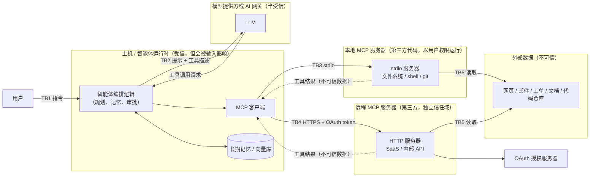

# MCP 服务器与工具型智能体的威胁模型

MCP（Model Context Protocol，模型上下文协议）是一个开放协议。MCP 服务器向客户端暴露工具（tools）、资源和提示模板；工具由模型自主发现和调用（[MCP 规范 2025-11-25：Tools](https://modelcontextprotocol.io/specification/2025-11-25/server/tools)）。一旦模型能调用工具，攻击面就从"模型说错话"变成"模型替攻击者做事"。

本文按威胁逐条给出：机制、真实案例、对应的 OWASP 编号、缓解措施。不提供可用的利用载荷。

引用的分类体系：

- **LLM01–LLM10**：[OWASP Top 10 for LLM Applications 2025](https://genai.owasp.org/llm-top-10/)。
- **ASI01–ASI10**：[OWASP Top 10 for Agentic Applications 2026](https://genai.owasp.org/resource/owasp-top-10-for-agentic-applications-for-2026/)，2025 年 12 月发布。条目名称参考 [OSA 的映射页](https://www.opensecurityarchitecture.org/frameworks/owasp-agentic-top-10-2026/)。
- **T1–T15**：OWASP 智能体安全倡议的 [Agentic AI – Threats and Mitigations](https://genai.owasp.org/resource/agentic-ai-threats-and-mitigations/)，2025 年 2 月发布。编号与名称参考 [MAESTRO 威胁分类整理](https://github.com/agentic-threat-modeling/MAESTRO/blob/main/playbook/02-threat-taxonomy.md)。

## 1. 信任边界

各边界上要回答的问题：

| 边界 | 跨越的内容 | 关键问题 |
|---|---|---|
| TB1 用户 → 智能体 | 用户指令 | 用户本人是否可信？多租户时用户之间是否隔离？ |
| TB2 智能体 ↔ LLM | 系统提示、上下文、工具描述、工具调用 | 模型输出是否被当作指令直接执行？中间的 AI 网关是否可信？ |
| TB3 客户端 → 本地服务器 | 启动命令、参数、环境变量 | 启动的是谁的代码？以什么权限运行？ |
| TB4 客户端 → 远程服务器 | OAuth token、工具参数 | token 的受众（audience）和范围（scope）是否最小？ |
| TB5 服务器 → 外部数据 | 网页、工单、邮件等 | 这些内容会回流进模型上下文，是间接提示注入的主要入口。 |

一条实用的判断规则来自 Simon Willison 提出的"致命三要素"（lethal trifecta）：智能体同时具备**访问私有数据**、**接触不可信内容**、**对外通信**三种能力时，提示注入就能导致数据外泄（[Simon Willison](https://simonwillison.net/2025/Jun/16/the-lethal-trifecta/)）。设计时至少切断其中一项。

## 2. 威胁总表

| # | 威胁 | OWASP LLM 2025 | OWASP Agentic 2026 | OWASP T 编号 |
|---|---|---|---|---|
| 2.1 | 直接提示注入 | [LLM01](https://genai.owasp.org/llmrisk/llm01-prompt-injection/) | ASI01 智能体目标劫持 | T6 |
| 2.2 | 间接提示注入 | [LLM01](https://genai.owasp.org/llmrisk/llm01-prompt-injection/) | ASI01 | T6、T12 |
| 2.3 | 工具投毒 | [LLM01](https://genai.owasp.org/llmrisk/llm01-prompt-injection/)、[LLM03](https://genai.owasp.org/llmrisk/llm032025-supply-chain/) | ASI02 工具滥用、ASI04 智能体供应链 | T2 |
| 2.4 | 工具描述"抽地毯"（rug pull）与工具遮蔽 | [LLM03](https://genai.owasp.org/llmrisk/llm032025-supply-chain/) | ASI04 | T2、T13 |
| 2.5 | 混淆代理 / 过宽凭据 | [LLM06](https://genai.owasp.org/llmrisk/llm062025-excessive-agency/) | ASI03 身份与权限滥用 | T3、T9 |
| 2.6 | 工具处理函数中的命令注入 | [LLM05](https://genai.owasp.org/llmrisk/llm052025-improper-output-handling/) | ASI05 意外代码执行 | T11 |
| 2.7 | SSRF | [LLM05](https://genai.owasp.org/llmrisk/llm052025-improper-output-handling/)、[LLM06](https://genai.owasp.org/llmrisk/llm062025-excessive-agency/) | ASI02 | T2 |
| 2.8 | 经工具输出的数据外泄 | [LLM02](https://genai.owasp.org/llmrisk/llm022025-sensitive-information-disclosure/) | ASI01、ASI02 | T2、T12 |
| 2.9 | MCP 服务器供应链 | [LLM03](https://genai.owasp.org/llmrisk/llm032025-supply-chain/) | ASI04 | T13 |
| 2.10 | 记忆投毒 | [LLM04](https://genai.owasp.org/llmrisk/llm042025-data-and-model-poisoning/)、[LLM08](https://genai.owasp.org/llmrisk/llm082025-vector-and-embedding-weaknesses/) | ASI06 记忆与上下文投毒 | T1 |
| 2.11 | 过度代理（excessive agency） | [LLM06](https://genai.owasp.org/llmrisk/llm062025-excessive-agency/) | ASI02、ASI03、ASI09 人机信任利用 | T3、T10 |
| 2.12 | 无法追溯 | — | ASI10 失控智能体 | T8 |

OWASP 没有官方给出 LLM 编号与 ASI 编号的一一对应。上表的映射是本文作者按条目定义做的判断。

## 3. 逐项分析

下面各小节的编号与威胁总表的 # 列一致。

### 2.1 直接提示注入

**机制**：用户在输入中直接要求模型忽略系统提示、调用不该调用的工具或泄露系统提示（[LLM01](https://genai.owasp.org/llmrisk/llm01-prompt-injection/)、[LLM07](https://genai.owasp.org/llmrisk/llm072025-system-prompt-leakage/)）。在工具型智能体里，危害取决于该用户能触达哪些工具。

**缓解措施**：

- 授权放在工具和后端，不放在提示里。系统提示不是安全边界，也不要在其中放密钥。
- 多租户场景下，每个用户的工具调用使用该用户自己的凭据，而不是智能体的共享凭据。
- 高风险工具需要单独审批（见 2.11）。

### 2.2 间接提示注入

**机制**：攻击者不接触智能体，而是把指令藏在智能体会读到的外部内容里：网页、邮件、工单、PR 评论、文档。工具结果回到模型上下文后，模型可能把其中的文字当成指令。

**案例**：Invariant Labs 演示了官方 GitHub MCP 服务器的"有毒智能体流"（toxic agent flow）。攻击者在公开仓库提一个恶意 issue；用户让智能体"看看 issue"时，智能体读取私有仓库的内容并把它发到公开仓库的 PR 里（[Invariant Labs](https://invariantlabs.ai/blog/mcp-github-vulnerability)）。这里没有代码漏洞可修，问题在于一个会话同时拥有不可信输入和私有数据的访问权限。

**缓解措施**：

- **把工具输出当数据，不当指令**。在上下文中给工具结果加明确的来源标记；编排层不根据工具结果里的文字改变计划或权限。
- 按任务限定可访问范围，例如一个会话只能访问一个仓库（Invariant 给出的建议之一）。
- 读取不可信内容的会话降级：禁用写操作和对外通信工具，或要求逐次人工确认。
- 提示注入检测器可作为一层信号，但不能作为唯一防线。

### 2.3 工具投毒（tool poisoning）

**机制**：恶意 MCP 服务器在工具的 `description` 或参数 schema 里写入给模型看的指令。用户界面通常只显示工具名，模型却会读完整描述，于是可能在调用"加法"工具时顺带读取本地敏感文件并作为参数传出（[Invariant Labs](https://invariantlabs.ai/blog/mcp-security-notification-tool-poisoning-attacks)）。工具不需要被调用，只要被列出、进入上下文，就可能生效。

MCP 规范要求客户端把工具注解（annotations）视为不可信，除非来自受信服务器（[MCP 规范：Tools](https://modelcontextprotocol.io/specification/2025-11-25/server/tools)）。同样的态度应扩展到工具描述本身。

**缓解措施**：

- 在客户端向用户完整展示工具描述和 schema，而不只显示名称。
- 接入前用扫描工具检查工具描述中的隐藏指令（如 Invariant 的 [MCP-Scan](https://invariantlabs.ai/blog/introducing-mcp-scan)），并人工复核。
- 只接入来源可信、经过审查的服务器（见 2.9）。

### 2.4 Rug pull 与工具遮蔽（shadowing）

**机制**：

- **Rug pull**：服务器在用户批准后修改工具定义。MCP 允许服务器通过 `notifications/tools/list_changed` 通知客户端工具列表已变（[MCP 规范：Tools](https://modelcontextprotocol.io/specification/2025-11-25/server/tools)），一次性的安装确认挡不住后续变更。Invariant 的实验代码演示了一个第二次加载时才换成恶意接口的服务器（[mcp-injection-experiments](https://github.com/invariantlabs-ai/mcp-injection-experiments)）。
- **工具遮蔽**：一个恶意服务器的工具描述去影响模型如何使用**另一个受信服务器**的工具，例如要求所有发出的邮件都附带抄送（[Invariant Labs](https://invariantlabs.ai/blog/mcp-security-notification-tool-poisoning-attacks)）。

**缓解措施**：

- **固定（pin）工具定义**：记录每个工具名、描述和 schema 的哈希；变化时停止使用并重新征得用户同意（[MCP-Scan](https://invariantlabs.ai/blog/introducing-mcp-scan) 采用此思路）。
- 固定服务器版本（包版本加哈希，或镜像摘要），不使用 `latest`。
- 不同信任等级的服务器不放进同一个会话，或至少在上下文中隔离它们的描述。

### 2.5 混淆代理与过宽凭据

**机制**：

- MCP 代理服务器用一个静态 client ID 对接第三方授权服务器时，攻击者可利用已有的同意 cookie，在用户未再次同意的情况下拿到授权码（[MCP 安全最佳实践：Confused Deputy](https://modelcontextprotocol.io/specification/draft/basic/security_best_practices)）。
- **Token 透传**：MCP 服务器接受并转发并非签发给自己的 token。下游 API 会误以为请求已经被校验过。规范明确要求 MCP 服务器不得接受非签发给自己的 token（同上，Token Passthrough 一节）。
- 一个 token 带着 `*`、`full-access` 这类宽泛 scope。被注入的智能体能做的事就等于这个 token 能做的事（同上，Scope Minimization 一节）。

**缓解措施**：

- **最小权限 token**：按工具、按任务签发短期 token；scope 只覆盖当前操作；校验 audience。
- 代理服务器对每个动态注册的客户端单独征得用户同意（按 [MCP 授权规范](https://modelcontextprotocol.io/specification/2025-11-25/basic/authorization) 实现）。
- 智能体使用独立身份，不复用人类管理员或共享服务账号。
- 凭据放在 MCP 服务器侧或密钥管理服务里，不进入模型上下文。

### 2.6 工具处理函数中的命令注入

**机制**：工具参数由模型生成，模型又可能被注入控制，所以工具参数等同于攻击者输入。处理函数如果把参数拼进 shell 命令、SQL 或文件路径，就是传统注入漏洞。MCP 客户端和网关同样会犯这个错误。

**案例**：

- CVE-2025-6514：`mcp-remote`（把客户端桥接到远程 MCP 服务器的 npm 包）在 OAuth 流程中把恶意服务器返回的授权地址直接交给操作系统，导致客户端机器上任意命令执行，CVSS 9.6，0.1.16 修复（[NVD](https://nvd.nist.gov/vuln/detail/CVE-2025-6514)、[JFrog](https://jfrog.com/blog/2025-6514-critical-mcp-remote-rce-vulnerability/)）。
- CVE-2026-42271：LiteLLM 的 MCP 测试端点按请求体里的 stdio 配置启动子进程，已被列入 CISA KEV（详见 [LiteLLM 案例](../01-litellm-case/README.md)）。
- MCP 规范指出，在代理架构中，stdio 传输会把前端的 XSS 等漏洞升级为主机上的任意命令执行（[MCP 安全最佳实践：stdio Transport Security in Proxy Scenarios](https://modelcontextprotocol.io/specification/draft/basic/security_best_practices)）。

**缓解措施**：

- 不经 shell 调用子进程，参数用数组传入；对路径做规范化并限制在工作目录内；SQL 用参数绑定（[LLM05](https://genai.owasp.org/llmrisk/llm052025-improper-output-handling/)）。
- 用 `inputSchema` 严格约束参数，并在服务器端再校验一次，不信任客户端。
- **沙箱**：MCP 服务器在容器或沙箱中运行，限制文件系统、网络和系统调用（MCP 规范对 stdio 代理的建议）。
- 启动本地服务器前，向用户展示完整命令并要求明确同意（MCP 规范中对一键配置的要求）。

### 2.7 SSRF

**机制**：

- 工具接受 URL 参数（抓网页、调 webhook），被注入后访问内网服务或云元数据地址 `169.254.169.254`。
- MCP 客户端在 OAuth 元数据发现时会请求服务器指定的 URL。恶意服务器可以把这些 URL 指向内网或元数据服务（[MCP 安全最佳实践：SSRF](https://modelcontextprotocol.io/specification/draft/basic/security_best_practices)）。
- AI 网关的变体：请求参数改写上游地址，代理带着提供商 Key 访问攻击者地址（LiteLLM CVE-2026-84377，[NVD](https://nvd.nist.gov/vuln/detail/CVE-2026-84377)）。

**缓解措施**：

- **出站白名单**：MCP 服务器和客户端的出站流量经出口代理，只允许已知域名。
- 拒绝私有、回环、链路本地地址；解析 DNS 后再校验 IP，防止 DNS 重绑定；生产环境要求 HTTPS（MCP 规范的建议）。
- 云上启用 IMDSv2 并限制跳数（[AWS 文档](https://docs.aws.amazon.com/AWSEC2/latest/UserGuide/configuring-instance-metadata-service.html)）。
- 不允许请求参数决定"带凭据的请求发往哪里"。

### 2.8 经工具输出的数据外泄

**机制**：被注入的智能体把私有数据放进一个能出网的动作里：发邮件、建 PR、发 HTTP 请求、写公开文档，或在渲染 Markdown 时加载一个带数据的外部图片 URL（[LLM02](https://genai.owasp.org/llmrisk/llm022025-sensitive-information-disclosure/)）。GitHub MCP 案例就是通过创建公开 PR 外泄的（[Invariant Labs](https://invariantlabs.ai/blog/mcp-github-vulnerability)）。

**缓解措施**：

- 切断致命三要素中的"对外通信"一项：读取过不可信内容后，禁止或审批所有出网动作。
- 客户端不自动加载模型输出中的外部图片和链接，或只允许白名单域名。
- 对出站内容做敏感信息检测（密钥格式、个人信息）。
- **审计日志**记录每次工具调用的参数和目的地，便于发现异常外发。

### 2.9 MCP 服务器供应链

**机制**：MCP 服务器多以 npm / PyPI 包或容器镜像分发，本地服务器以用户权限运行。恶意包、仿冒包或被接管的维护者账号都能直接拿到用户机器（[MCP 安全最佳实践：Local MCP Server Compromise](https://modelcontextprotocol.io/specification/draft/basic/security_best_practices)）。

**案例**：

- `postmark-mcp`：npm 上仿冒 Postmark 官方库的 MCP 服务器，从 1.0.16（2025-09-17）起在每封发出的邮件里加入攻击者的密送地址，被 Koi Security 发现（[THN](https://thehackernews.com/2025/09/first-malicious-mcp-server-found.html)）。
- LiteLLM 1.82.7/1.82.8 PyPI 投毒：官方指出，经智能体框架或 MCP 服务器间接引入的未锁版本依赖同样会中招（[LiteLLM 官方公告](https://docs.litellm.ai/blog/security-update-march-2026)）。

**缓解措施**：

- **签名并固定 MCP 服务器**：只从内部审核过的注册表安装；锁版本加哈希或镜像摘要；能验证来源证明（provenance）的就验证。
- 禁止 `npx some-mcp@latest` 这类每次启动都拉最新版的配置。
- 为智能体运行环境生成 SBOM，公告一出即可反查。
- 本地服务器放进沙箱，即使包被投毒，也拿不到 SSH 密钥、云凭据和浏览器数据。

### 2.10 记忆投毒

**机制**：智能体有长期记忆或 RAG 知识库时，攻击者通过一次注入写入错误的"事实"或"偏好"，影响之后所有会话，包括其他用户的会话（[ASI06](https://genai.owasp.org/resource/owasp-top-10-for-agentic-applications-for-2026/)、T1）。向量库还可能被利用来绕过访问控制或跨租户泄露（[LLM08](https://genai.owasp.org/llmrisk/llm082025-vector-and-embedding-weaknesses/)）。

**缓解措施**：

- 记忆写入需要明确来源：只有用户本人确认的内容才写入长期记忆；工具结果不能直接写入。
- 记忆条目带来源、时间和作者，可审计、可撤销；定期过期。
- 记忆和向量库按用户 / 租户隔离，检索时做权限过滤。
- 读取记忆时同样当作数据，不当作指令。

### 2.11 过度代理

**机制**：智能体拥有超出任务所需的功能、权限或自主性（[LLM06](https://genai.owasp.org/llmrisk/llm062025-excessive-agency/)）。任何上面的注入一旦成功，造成的损害都由这一项放大。另一面是审批疲劳：确认请求太多，人会不看就批（T10）。

**缓解措施**：

- 只挂载当前任务需要的工具；能只读就只读。
- **不可逆操作需要人工审批**：删除、转账、发外部邮件、部署、改权限。MCP 规范建议始终保留人工拒绝工具调用的能力，并对操作给出确认提示（[MCP 规范：Tools](https://modelcontextprotocol.io/specification/2025-11-25/server/tools)）。
- 审批界面展示完整参数和目的地，而不是模型写的摘要。
- 按风险分级审批：低风险自动执行，高风险逐次确认，减少无效确认。
- 设置速率和预算上限，防止循环调用失控（[LLM10](https://genai.owasp.org/llmrisk/llm102025-unbounded-consumption/)）。

### 2.12 无法追溯

**机制**：没有工具调用日志，就无法判断某个动作是用户要求的、模型自行决定的，还是被注入的（T8）。

**缓解措施**：

- **审计日志**：记录每次工具调用的时间、会话、用户、工具、完整参数、结果摘要、审批人；日志写入智能体无法修改的位置。
- 记录工具定义的哈希，事后可以确认当时模型看到的是哪个版本的描述。
- 对日志做告警：新服务器接入、工具定义变化、出站到新域名、高风险工具调用。

## 4. 缓解措施速查

| 措施 | 主要应对 |
|---|---|
| 最小权限、短期、限定 audience 的 token | 2.5、2.11 |
| 不可逆操作人工审批 | 2.2、2.8、2.11 |
| 工具输出当数据，不当指令 | 2.2、2.3、2.10 |
| 出站白名单 + 拒绝内网地址 | 2.7、2.8 |
| 沙箱运行 MCP 服务器 | 2.6、2.9 |
| 签名、固定版本、固定工具定义哈希 | 2.3、2.4、2.9 |
| 参数化调用、服务器端输入校验 | 2.6、2.7 |
| 记忆写入需确认、按租户隔离 | 2.10 |
| 不可篡改的审计日志 | 2.8、2.12 |
| 切断"私有数据 + 不可信内容 + 对外通信"中的一项 | 2.2、2.8 |

更细的实现建议见 [OWASP AI Agent Security Cheat Sheet](https://cheatsheetseries.owasp.org/cheatsheets/AI_Agent_Security_Cheat_Sheet.html) 和 [MCP 安全最佳实践](https://modelcontextprotocol.io/specification/draft/basic/security_best_practices)。

---

Content was rephrased for compliance with licensing restrictions
